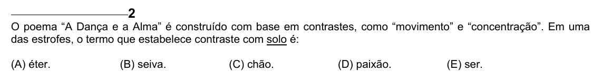

Texto extraído (pode conter ruído)

2  
O poema “A Dança e a Alma” é construído com base em contrastes, como “movimento” e “concentração”. Em uma  
das estrofes, o termo que estabelece contraste com solo é:  
(A) éter.  
(B) seiva.  
(C) chão.  
(D) paixão.  
(E) ser.

