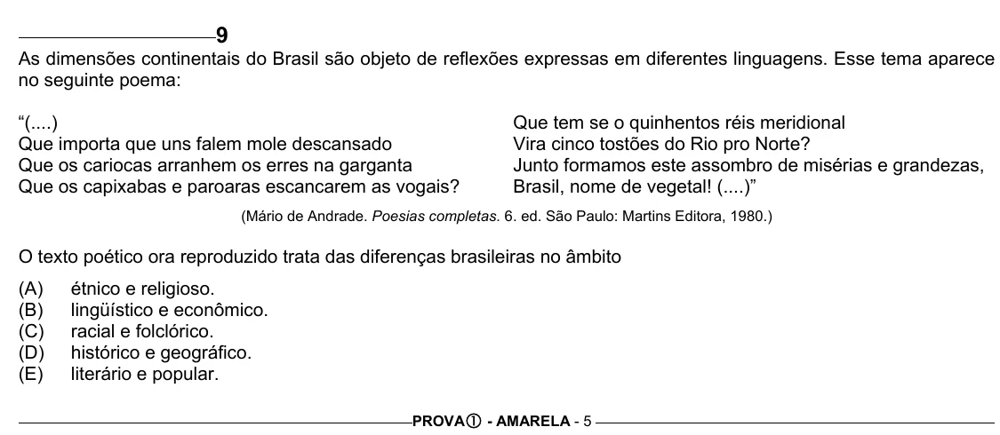

Texto extraído (pode conter ruído)

9  
As dimensões continentais do Brasil são objeto de reflexões expressas em diferentes linguagens. Esse tema aparece  
no seguinte poema:  
“(....)  
Que tem se o quinhentos réis meridional  
Que importa que uns falem mole descansado  
Vira cinco tostões do Rio pro Norte?  
Que os cariocas arranhem os erres na garganta  
Junto formamos este assombro de misérias e grandezas,  
Que os capixabas e paroaras escancarem as vogais?  
Brasil, nome de vegetal! (....)”  
(Mário de Andrade. Poesias completas. 6. ed. São Paulo: Martins Editora, 1980.)  
O texto poético ora reproduzido trata das diferenças brasileiras no âmbito  
(A)  
étnico e religioso.  
(B)  
lingüístico e econômico.  
(C)  
racial e folclórico.  
(D)  
histórico e geográfico.  
(E)  
literário e popular.  
PROVA c - AMARELA - 5

