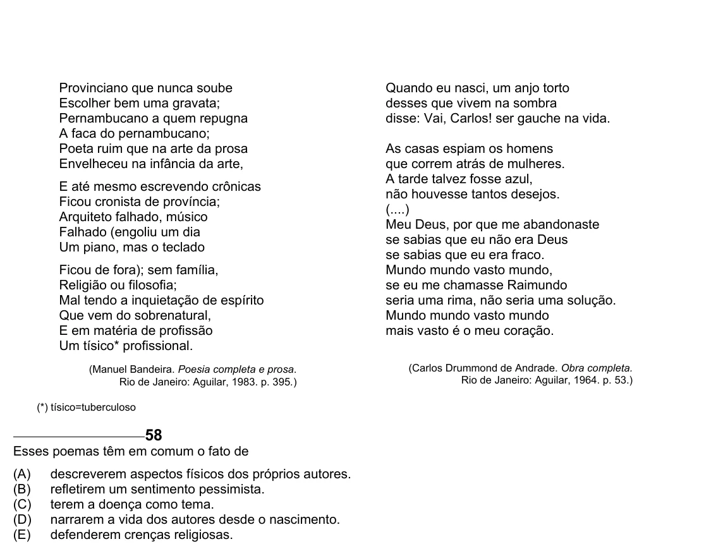

Texto extraído (pode conter ruído)

Provinciano que nunca soube  
Quando eu nasci, um anjo torto  
Escolher bem uma gravata;  
desses que vivem na sombra  
Pernambucano a quem repugna  
disse: Vai, Carlos! ser gauche na vida.  
A faca do pernambucano;  
Poeta ruim que na arte da prosa  
As casas espiam os homens  
Envelheceu na infância da arte,  
que correm atrás de mulheres.  
A tarde talvez fosse azul,  
E até mesmo escrevendo crônicas  
não houvesse tantos desejos.  
Ficou cronista de província;  
(....)  
Arquiteto falhado, músico  
Meu Deus, por que me abandonaste  
Falhado (engoliu um dia  
se sabias que eu não era Deus  
Um piano, mas o teclado  
se sabias que eu era fraco.  
Ficou de fora); sem família,  
Mundo mundo vasto mundo,  
Religião ou filosofia;  
se eu me chamasse Raimundo  
Mal tendo a inquietação de espírito  
seria uma rima, não seria uma solução.  
Que vem do sobrenatural,  
Mundo mundo vasto mundo  
E em matéria de profissão  
mais vasto é o meu coração.  
Um tísico* profissional.  
(Manuel Bandeira. Poesia completa e prosa.  
(Carlos Drummond de Andrade. Obra completa.  
Rio de Janeiro: Aguilar, 1983. p. 395.)  
Rio de Janeiro: Aguilar, 1964. p. 53.)  
(*) tísico=tuberculoso  
58  
Esses poemas têm em comum o fato de  
(A)  
descreverem aspectos físicos dos próprios autores.  
(B)  
refletirem um sentimento pessimista.  
(C)  
terem a doença como tema.  
(D)  
narrarem a vida dos autores desde o nascimento.  
(E)  
defenderem crenças religiosas.

