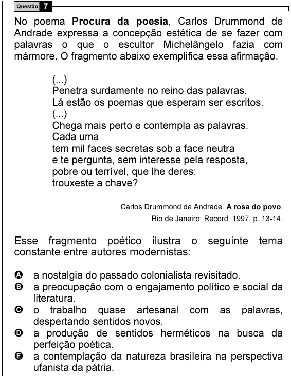

Texto extraído (pode conter ruído)

7  
Questão  
No poema Procura da poesia, Carlos Drummond de  
Andrade expressa a concepção estética de se fazer com  
palavras o que o escultor Michelângelo fazia com  
mármore. O fragmento abaixo exemplifica essa afirmação.  
(...)  
Penetra surdamente no reino das palavras.  
Lá estão os poemas que esperam ser escritos.  
(...)  
Chega mais perto e contempla as palavras.  
Cada uma  
tem mil faces secretas sob a face neutra  
e te pergunta, sem interesse pela resposta,  
pobre ou terrível, que lhe deres:  
trouxeste a chave?  
Carlos Drummond de Andrade. A rosa do povo.  
Rio de Janeiro: Record, 1997, p. 13-14.  
Esse fragmento poético ilustra o seguinte tema  
constante entre autores modernistas:  
A a nostalgia do passado colonialista revisitado.  
B a preocupação com o engajamento político e social da  
literatura.  
C o trabalho quase artesanal com as palavras,  
despertando sentidos novos.  
D a produção de sentidos herméticos na busca da  
perfeição poética.  
E a contemplação da natureza brasileira na perspectiva  
ufanista da pátria.

