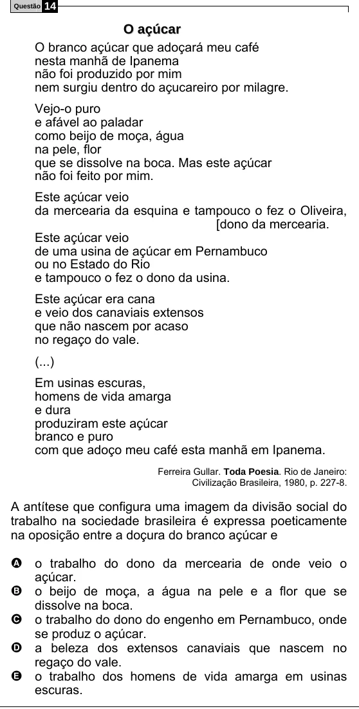

Texto extraído (pode conter ruído)

Questão  
14  
O a ç ú c a r  
O branco açúcar que adoçará meu café  
nesta manhã de Ipanema  
não foi produzido por mim  
nem surgiu dentro do açucareiro por milagre.  
Vejo-o puro  
e afável ao paladar  
como beijo de moça, água  
na pele, flor  
que se dissolve na boca. Mas este açúcar  
não foi feito por mim.  
Este açúcar veio  
da mercearia da esquina e tampouco o fez o Oliveira,  
[dono da mercearia.  
Este açúcar veio  
de uma usina de açúcar em Pernambuco  
ou no Estado do Rio  
e tampouco o fez o dono da usina.  
Este açúcar era cana  
e veio dos canaviais extensos  
que não nascem por acaso  
no regaço do vale.  
(...)  
Em usinas escuras,  
homens de vida amarga  
e dura  
produziram este açúcar  
branco e puro  
com que adoço meu café esta manhã em Ipanema.  
Ferreira Gullar. Toda Poesia. Rio de Janeiro:  
Civilização Brasileira, 1980, p. 227-8.  
A antítese que configura uma imagem da divisão social do  
trabalho na sociedade brasileira é expressa poeticamente  
na oposição entre a doçura do branco açúcar e  
A o trabalho do dono da mercearia de onde veio o  
açúcar.  
B o beijo de moça, a água na pele e a flor que se  
dissolve na boca.  
C o trabalho do dono do engenho em Pernambuco, onde  
se produz o açúcar.  
D a beleza dos extensos canaviais que nascem no  
regaço do vale.  
E o trabalho dos homens de vida amarga em usinas  
escuras.

