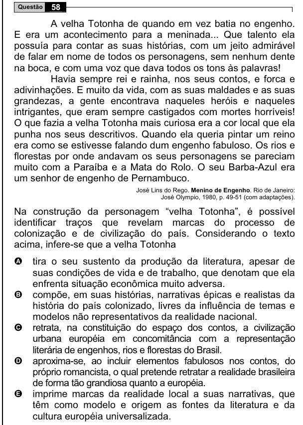

Texto extraído (pode conter ruído)

58  
Questão  
A velha Totonha de quando em vez batia no engenho.  
E era um acontecimento para a meninada... Que talento ela  
possuía para contar as suas histórias, com um jeito admirável  
de falar em nome de todos os personagens, sem nenhum dente  
na boca, e com uma voz que dava todos os tons às palavras!  
Havia sempre rei e rainha, nos seus contos, e forca e  
adivinhações. E muito da vida, com as suas maldades e as suas  
grandezas, a gente encontrava naqueles heróis e naqueles  
intrigantes, que eram sempre castigados com mortes horríveis!  
O que fazia a velha Totonha mais curiosa era a cor local que ela  
punha nos seus descritivos. Quando ela queria pintar um reino  
era como se estivesse falando dum engenho fabuloso. Os rios e  
florestas por onde andavam os seus personagens se pareciam  
muito com a Paraíba e a Mata do Rolo. O seu Barba-Azul era  
um senhor de engenho de Pernambuco.  
José Lins do Rego. Menino de Engenho. Rio de Janeiro:  
José Olympio, 1980, p. 49-51 (com adaptações).  
Na construção da personagem “velha Totonha”, é possível  
identificar traços que revelam marcas do processo de  
colonização e de civilização do país. Considerando o texto  
acima, infere-se que a velha Totonha  
A  
tira o seu sustento da produção da literatura, apesar de  
suas condições de vida e de trabalho, que denotam que ela  
enfrenta situação econômica muito adversa.  
compõe, em suas histórias, narrativas épicas e realistas da  
B  
história do país colonizado, livres da influência de temas e  
modelos não representativos da realidade nacional.  
retrata, na constituição do espaço dos contos, a civilização  
C  
urbana européia em concomitância com a representação  
literária de engenhos, rios e florestas do Brasil.  
D  
aproxima-se, ao incluir elementos fabulosos nos contos, do  
próprio romancista, o qual pretende retratar a realidade brasileira  
de forma tão grandiosa quanto a européia.  
imprime marcas da realidade local a suas narrativas, que  
E  
têm como modelo e origem as fontes da literatura e da  
cultura européia universalizada.

