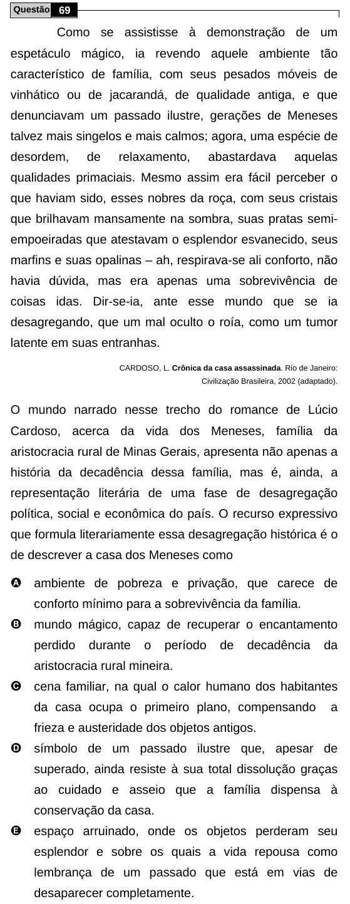

Texto extraído (pode conter ruído)

Questão 69  
Como se assistisse à demonstração de um  
espetáculo mágico, ia revendo aquele ambiente tão  
característico de família, com seus pesados móveis de  
vinhático ou de jacarandá, de qualidade antiga, e que  
denunciavam um passado ilustre, gerações de Meneses  
talvez mais singelos e mais calmos; agora, uma espécie de  
desordem,  
de  
relaxamento,  
abastardava  
aquelas  
qualidades primaciais. Mesmo assim era fácil perceber o  
que haviam sido, esses nobres da roça, com seus cristais  
que brilhavam mansamente na sombra, suas pratas semi-  
empoeiradas que atestavam o esplendor esvanecido, seus  
marfins e suas opalinas – ah, respirava-se ali conforto, não  
havia dúvida, mas era apenas uma sobrevivência de  
coisas idas. Dir-se-ia, ante esse mundo que se ia  
desagregando, que um mal oculto o roía, como um tumor  
latente em suas entranhas.  
CARDOSO, L. Crônica da casa assassinada. Rio de Janeiro:  
Civilização Brasileira, 2002 (adaptado).  
O mundo narrado nesse trecho do romance de Lúcio  
Cardoso, acerca da vida dos Meneses, família da  
aristocracia rural de Minas Gerais, apresenta não apenas a  
história da decadência dessa família, mas é, ainda, a  
representação literária de uma fase de desagregação  
política, social e econômica do país. O recurso expressivo  
que formula literariamente essa desagregação histórica é o  
de descrever a casa dos Meneses como  
A ambiente de pobreza e privação, que carece de  
conforto mínimo para a sobrevivência da família.  
B mundo mágico, capaz de recuperar o encantamento  
perdido  
durante  
o  
período  
de  
decadência  
da  
aristocracia rural mineira.  
C cena familiar, na qual o calor humano dos habitantes  
da casa ocupa o primeiro plano, compensando  
a  
frieza e austeridade dos objetos antigos.  
D símbolo de um passado ilustre que, apesar de  
superado, ainda resiste à sua total dissolução graças  
ao cuidado e asseio que a família dispensa à  
conservação da casa.  
E espaço arruinado, onde os objetos perderam seu  
esplendor e sobre os quais a vida repousa como  
lembrança de um passado que está em vias de  
desaparecer completamente.

