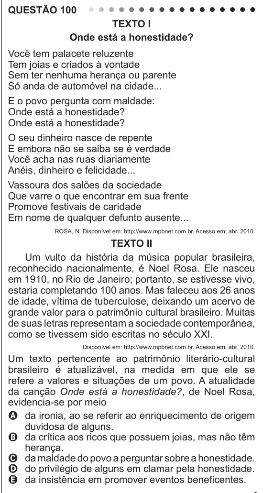

Texto extraído (pode conter ruído)

QUESTÃO 100  
Texto I  
Onde está a honestidade?  
Você tem palacete reluzente  
Tem joias e criados à vontade  
Sem ter nenhuma herança ou parente  
Só anda de automóvel na cidade...  
E o povo pergunta com maldade:  
Onde está a honestidade?  
Onde está a honestidade?  
O seu dinheiro nasce de repente  
E embora não se saiba se é verdade  
Você acha nas ruas diariamente  
Anéis, dinheiro e felicidade...  
Vassoura dos salões da sociedade  
Que varre o que encontrar em sua frente  
Promove festivais de caridade  
Em nome de qualquer defunto ausente...  
ROSA, N. Disponível em: http://www.mpbnet.com.br. Acesso em: abr. 2010.  
Texto II  
Um vulto da história da música popular brasileira,  
reconhecido nacionalmente, é Noel Rosa. Ele nasceu  
em 1910, no Rio de Janeiro; portanto, se estivesse vivo,  
estaria completando 100 anos. Mas faleceu aos 26 anos  
de idade, vítima de tuberculose, deixando um acervo de  
grande valor para o patrimônio cultural brasileiro. Muitas  
de suas letras representam a sociedade contemporânea,  
como se tivessem sido escritas no século XXI.  
Disponível em: http://www.mpbnet.com.br. Acesso em: abr. 2010.  
Um texto pertencente ao patrimônio literário-cultural  
brasileiro é atualizável, na medida em que ele se  
refere a valores e situações de um povo. A atualidade  
da canção Onde está a honestidade?, de Noel Rosa,  
evidencia-se por meio  
A da ironia, ao se referir ao enriquecimento de origem  
duvidosa de alguns.  
B da crítica aos ricos que possuem joias, mas não têm  
herança.  
C da maldade do povo a perguntar sobre a honestidade.  
D do privilégio de alguns em clamar pela honestidade.  
E da insistência em promover eventos beneficentes.

