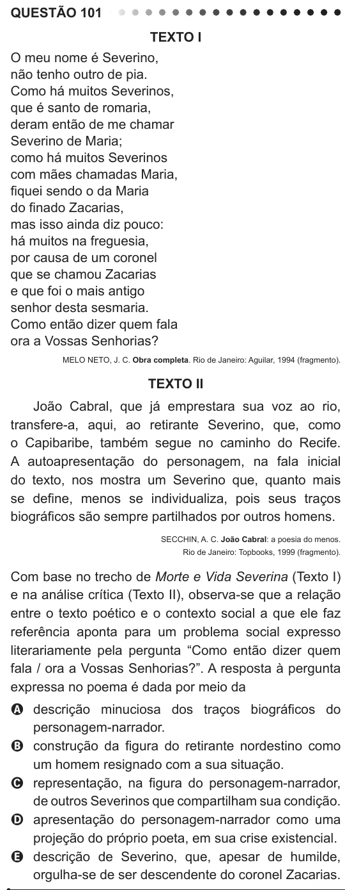

Texto extraído (pode conter ruído)

QUESTÃO 101  
Texto I  
O meu nome é Severino,  
não tenho outro de pia.  
Como há muitos Severinos,  
que é santo de romaria,  
deram então de me chamar  
Severino de Maria;  
como há muitos Severinos  
com mães chamadas Maria,  
fiquei sendo o da Maria  
do finado Zacarias,  
mas isso ainda diz pouco:  
há muitos na freguesia,  
por causa de um coronel  
que se chamou Zacarias  
e que foi o mais antigo  
senhor desta sesmaria.  
Como então dizer quem fala  
ora a Vossas Senhorias?  
MELO NETO, J. C. Obra completa. Rio de Janeiro: Aguilar, 1994 (fragmento).  
Texto II  
João Cabral, que já emprestara sua voz ao rio,  
transfere-a, aqui, ao retirante Severino, que, como  
o Capibaribe, também segue no caminho do Recife.  
A autoapresentação do personagem, na fala inicial  
do texto, nos mostra um Severino que, quanto mais  
se define, menos se individualiza, pois seus traços  
biográficos são sempre partilhados por outros homens.  
SECCHIN, A. C. João Cabral: a poesia do menos.  
Rio de Janeiro: Topbooks, 1999 (fragmento).  
Com base no trecho de Morte e Vida Severina (Texto I)  
e na análise crítica (Texto II), observa-se que a relação  
entre o texto poético e o contexto social a que ele faz  
referência aponta para um problema social expresso  
literariamente pela pergunta “Como então dizer quem  
fala / ora a Vossas Senhorias?”. A resposta à pergunta  
expressa no poema é dada por meio da  
A descrição minuciosa dos traços biográficos do  
personagem-narrador.  
B construção da figura do retirante nordestino como  
um homem resignado com a sua situação.  
C representação, na figura do personagem-narrador,  
de outros Severinos que compartilham sua condição.  
D apresentação do personagem-narrador como uma  
projeção do próprio poeta, em sua crise existencial.  
E descrição de Severino, que, apesar de humilde,  
orgulha-se de ser descendente do coronel Zacarias.

