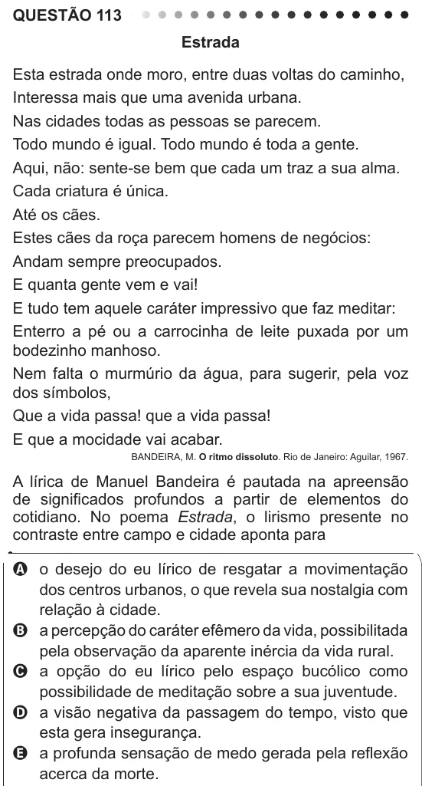

Texto extraído (pode conter ruído)

QUESTÃO 113  
Estrada  
Esta estrada onde moro, entre duas voltas do caminho,  
Interessa mais que uma avenida urbana.  
Nas cidades todas as pessoas se parecem.  
Todo mundo é igual. Todo mundo é toda a gente.  
Aqui, não: sente-se bem que cada um traz a sua alma.  
Cada criatura é única.  
Até os cães.  
Estes cães da roça parecem homens de negócios:  
Andam sempre preocupados.  
E quanta gente vem e vai!  
E tudo tem aquele caráter impressivo que faz meditar:  
Enterro a pé ou a carrocinha de leite puxada por um  
bodezinho manhoso.  
Nem falta o murmúrio da água, para sugerir, pela voz  
dos símbolos,  
Que a vida passa! que a vida passa!  
E que a mocidade vai acabar.  
BANDEIRA, M. O ritmo dissoluto. Rio de Janeiro: Aguilar, 1967.  
A lírica de Manuel Bandeira é pautada na apreensão  
de significados profundos a partir de elementos do  
cotidiano. No poema Estrada, o lirismo presente no  
contraste entre campo e cidade aponta para  
A o desejo do eu lírico de resgatar a movimentação  
dos centros urbanos, o que revela sua nostalgia com  
relação à cidade.  
B a percepção do caráter efêmero da vida, possibilitada  
pela observação da aparente inércia da vida rural.  
C a opção do eu lírico pelo espaço bucólico como  
possibilidade de meditação sobre a sua juventude.  
D a visão negativa da passagem do tempo, visto que  
esta gera insegurança.  
E a profunda sensação de medo gerada pela reflexão  
acerca da morte.

