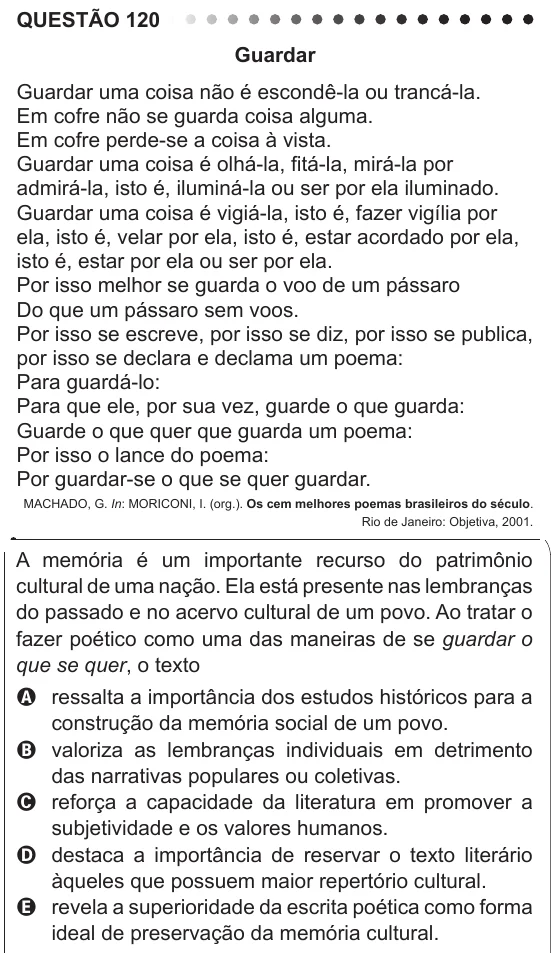

Texto extraído (pode conter ruído)

QUESTÃO 120  
Guardar  
Guardar uma coisa não é escondê-la ou trancá-la.  
Em cofre não se guarda coisa alguma.  
Em cofre perde-se a coisa à vista.  
Guardar uma coisa é olhá-la, fitá-la, mirá-la por  
admirá-la, isto é, iluminá-la ou ser por ela iluminado.  
Guardar uma coisa é vigiá-la, isto é, fazer vigília por  
ela, isto é, velar por ela, isto é, estar acordado por ela,  
isto é, estar por ela ou ser por ela.  
Por isso melhor se guarda o voo de um pássaro  
Do que um pássaro sem voos.  
Por isso se escreve, por isso se diz, por isso se publica,  
por isso se declara e declama um poema:  
Para guardá-lo:  
Para que ele, por sua vez, guarde o que guarda:  
Guarde o que quer que guarda um poema:  
Por isso o lance do poema:  
Por guardar-se o que se quer guardar.  
MACHADO, G. In: MORICONI, I. (org.). Os cem melhores poemas brasileiros do século.  
Rio de Janeiro: Objetiva, 2001.  
A memória é um importante recurso do patrimônio  
cultural de uma nação. Ela está presente nas lembranças  
do passado e no acervo cultural de um povo. Ao tratar o  
fazer poético como uma das maneiras de se guardar o  
que se quer, o texto  
A ressalta a importância dos estudos históricos para a  
construção da memória social de um povo.  
B valoriza as lembranças individuais em detrimento  
das narrativas populares ou coletivas.  
C reforça a capacidade da literatura em promover a  
subjetividade e os valores humanos.  
D destaca a importância de reservar o texto literário  
àqueles que possuem maior repertório cultural.  
E revela a superioridade da escrita poética como forma  
ideal de preservação da memória cultural.

