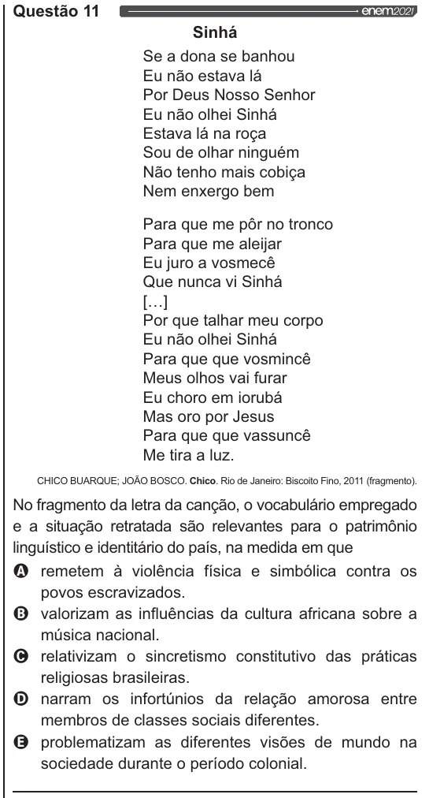

Texto extraído (pode conter ruído)

Questão 11  
Sinhá  
Se a dona se banhou  
Eu não estava lá  
Por Deus Nosso Senhor  
Eu não olhei Sinhá  
Estava lá na roça  
Sou de olhar ninguém  
Não tenho mais cobiça  
Nem enxergo bem  
Para que me pôr no tronco  
Para que me aleijar  
Eu juro a vosmecê  
Que nunca vi Sinhá  
[..]  
Por que talhar meu corpo  
Eu não olhei Sinhá  
Para que que vosmincê  
Meus olhos vai furar  
Eu choro em iorubá  
Mas oro por Jesus  
Para que que vassuncê  
Me tira a luz.  
CHICO BUARQUE; JOÃO BOSCO. Chico. Rio de Janeiro: Biscoito Fino, 2011 (fragmento).  
No fragmento da letra da canção, o vocabulário empregado  
e a situação retratada são relevantes para o patrimônio  
linguístico e identitário do país, na medida em que  
Q remetem à violência física e simbólica contra os  
povos escravizados.  
valorizam as influências da cultura africana sobre a  
música nacional.  
q O o  
relativizam o sincretismo constitutivo das práticas  
religiosas brasileiras.  
narram os infortúnios da relação amorosa entre  
membros de classes sociais diferentes.  
problematizam as diferentes visões de mundo na  
sociedade durante o período colonial.

