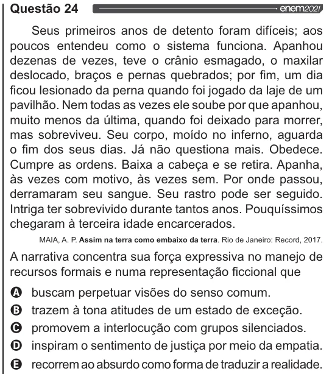

Texto extraído (pode conter ruído)

Questão 24  
Seus primeiros anos de detento foram difíceis; aos  
poucos entendeu como o sistema funciona. Apanhou  
dezenas de vezes, teve o crânio esmagado, o maxilar  
deslocado, braços e pernas quebrados; por fim, um dia  
ficou lesionado da perna quando foi jogado da laje de um  
pavilhão. Nem todas as vezes ele soube por que apanhou,  
muito menos da última, quando foi deixado para morrer,  
mas sobreviveu. Seu corpo, moído no inferno, aguarda  
o fim dos seus dias. Já não questiona mais. Obedece.  
Cumpre as ordens. Baixa a cabeça e se retira. Apanha,  
às vezes com motivo, às vezes sem. Por onde passou,  
derramaram seu sangue. Seu rastro pode ser seguido.  
Intriga ter sobrevivido durante tantos anos. Pouquíssimos  
chegaram à terceira idade encarcerados.  
MAIA, A. P. Assim na terra como embaixo da terra. Rio de Janeiro: Record, 2017.  
A narrativa concentra sua força expressiva no manejo de  
recursos formais e numa representação ficcional que  
Q buscam perpetuar visões do senso comum.  
O trazem à tona atitudes de um estado de exceção.  
O promovem a interlocução com grupos silenciados.  
O inspiram o sentimento de justiça por meio da empatia.  
& recorremao absurdo como forma de traduzir a realidade.

