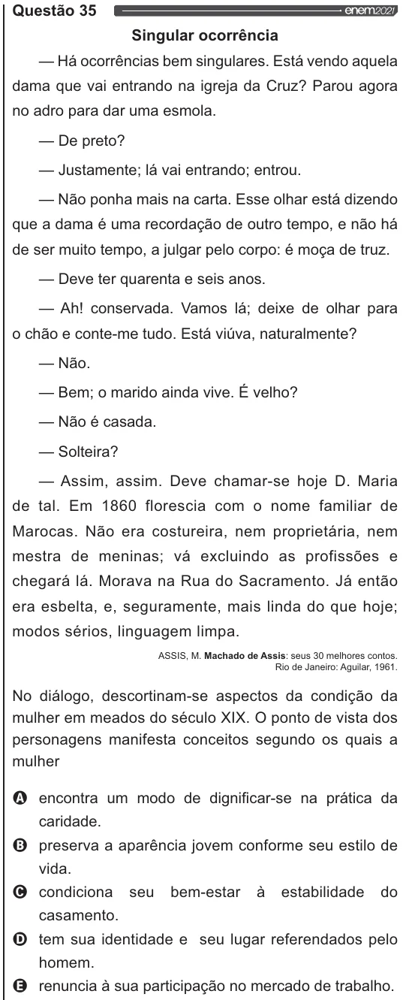

Texto extraído (pode conter ruído)

Questão 35  
Singular ocorrência  
— Há ocorrências bem singulares. Está vendo aquela  
dama que vai entrando na igreja da Cruz? Parou agora  
no adro para dar uma esmola.  
— De preto?  
— Justamente; lá vai entrando; entrou.  
— Não ponha mais na carta. Esse olhar está dizendo  
que a dama é uma recordação de outro tempo, e não há  
de ser muito tempo, a julgar pelo corpo: é moça de truz.  
— Deve ter quarenta e seis anos.  
— Ah! conservada. Vamos lá; deixe de olhar para  
o chão e conte-me tudo. Está viúva, naturalmente?  
— Não.  
— Bem; o marido ainda vive. É velho?  
— Não é casada.  
— Solteira?  
— Assim, assim. Deve chamar-se hoje D. Maria  
de tal. Em 1860 florescia com o nome familiar de  
Marocas. Não era costureira, nem proprietária, nem  
mestra de meninas; vá excluindo as profissões e  
chegará lá. Morava na Rua do Sacramento. Já então  
era esbelta, e, seguramente, mais linda do que hoje;  
modos sérios, linguagem limpa.  
ASSIS, M. Machado de Assis: seus 30 melhores contos.  
Rio de Janeiro: Aguilar, 1961.  
No diálogo, descortinam-se aspectos da condição da  
mulher em meados do século XIX. O ponto de vista dos  
personagens manifesta conceitos segundo os quais a  
mulher  
Q encontra um modo de dignificar-se na prática da  
caridade.  
oo O o  
preserva a aparência jovem conforme seu estilo de  
vida.  
condiciona seu bem-estar à estabilidade do  
casamento.  
tem sua identidade e seu lugar referendados pelo  
homem.  
renuncia à sua participação no mercado de trabalho.

