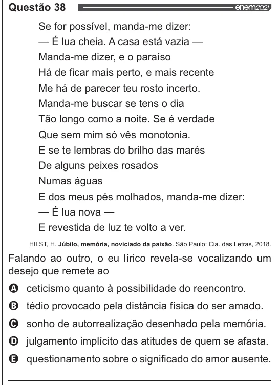

Texto extraído (pode conter ruído)

Questão 38  
Se for possível, manda-me dizer:  
— É lua cheia. A casa está vazia —  
Manda-me dizer, e o paraíso  
Há de ficar mais perto, e mais recente  
Me há de parecer teu rosto incerto.  
Manda-me buscar se tens o dia  
Tão longo como a noite. Se é verdade  
Que sem mim só vês monotonia.  
E se te lembras do brilho das marés  
De alguns peixes rosados  
Numas águas  
E dos meus pés molhados, manda-me dizer:  
— É lua nova —  
E revestida de luz te volto a ver.  
HILST, H. Júbilo, memória, noviciado da paixão. São Paulo: Cia. das Letras, 2018.  
Falando ao outro, o eu lírico revela-se vocalizando um  
desejo que remete ao  
OQ ceticismo quanto à possibilidade do reencontro.  
O tédio provocado pela distância física do ser amado.  
O sonho de autorrealização desenhado pela memória.  
O julgamento implícito das atitudes de quem se afasta.  
& questionamento sobre o significado do amor ausente.

