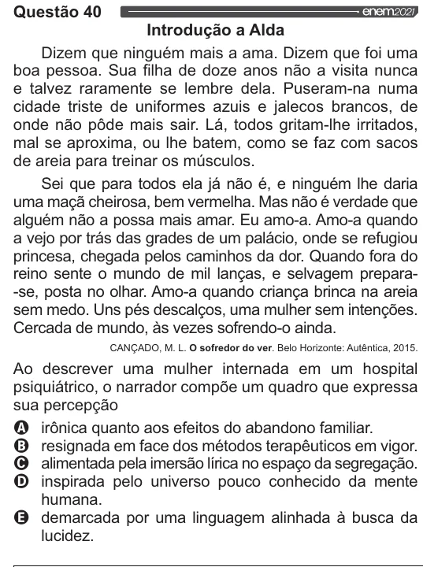

Texto extraído (pode conter ruído)

Questão 40  
Introdução a Alda  
Dizem que ninguém mais a ama. Dizem que foi uma  
boa pessoa. Sua filha de doze anos não a visita nunca  
e talvez raramente se lembre dela. Puseram-na numa  
cidade triste de uniformes azuis e jalecos brancos, de  
onde não pôde mais sair. Lá, todos gritam-lhe irritados,  
mal se aproxima, ou lhe batem, como se faz com sacos  
de areia para treinar os músculos.  
Sei que para todos ela já não é, e ninguém lhe daria  
uma maçã cheirosa, bem vermelha. Mas não é verdade que  
alguém não a possa mais amar. Eu amo-a. Amo-a quando  
a vejo por trás das grades de um palácio, onde se refugiou  
princesa, chegada pelos caminhos da dor. Quando fora do  
reino sente o mundo de mil lanças, e selvagem prepara-  
-se, posta no olhar. Amo-a quando criança brinca na areia  
sem medo. Uns pés descalços, uma mulher sem intenções.  
Cercada de mundo, às vezes sofrendo-o ainda.  
CANÇADO, M. L. O sofredor do ver. Belo Horizonte: Autêntica, 2015.  
Ao descrever uma mulher internada em um hospital  
psiquiátrico, o narrador compõe um quadro que expressa  
sua percepção  
LA)  
irônica quanto aos efeitos do abandono familiar.  
(B)  
resignada em face dos métodos terapêuticos em vigor.  
O alimentada pela imersão lírica no espaço da segregação. | Q utilização de medicamentos e produtos estéticos.  
O inspirada pelo universo pouco conhecido da mente | O educação do gesto, da vontade e do comportamento.  
humana. O construção de espaços para vivência de práticas corporais.  
& demarcada por uma linguagem alinhada à busca da | O promoção de novas experiências de movimento  
lucidez. humano no lazer.

