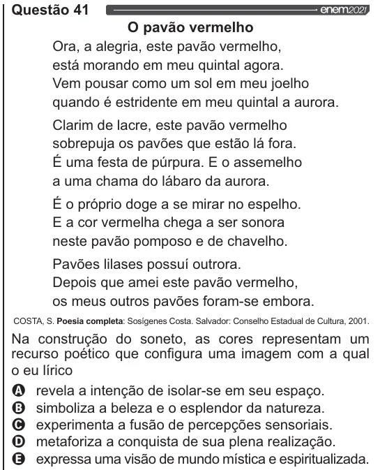

Texto extraído (pode conter ruído)

Questão 41  
O pavão vermelho  
Ora, a alegria, este pavão vermelho,  
está morando em meu quintal agora.  
Vem pousar como um sol em meu joelho  
quando é estridente em meu quintal a aurora.  
Clarim de lacre, este pavão vermelho  
sobrepuja os pavões que estão lá fora.  
É uma festa de púrpura. E o assemelho  
a uma chama do lábaro da aurora.  
É o próprio doge a se mirar no espelho.  
E a cor vermelha chega a ser sonora  
neste pavão pomposo e de chavelho.  
Pavões lilases possuí outrora.  
Depois que amei este pavão vermelho,  
os meus outros pavões foram-se embora.  
COSTA, S. Poesia completa: Sosigenes Costa. Salvador: Conselho Estadual de Cultura, 2001.  
Na construção do soneto, as cores representam um  
recurso poético que configura uma imagem com a qual  
o eu lírico  
VOOS  
revela a intenção de isolar-se em seu espaço.  
simboliza a beleza e o esplendor da natureza.  
experimenta a fusão de percepções sensoriais.  
metaforiza a conquista de sua plena realização.  
expressa uma visão de mundo mística e espiritualizada.

