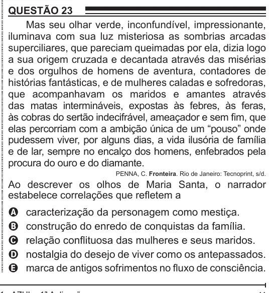

Texto extraído (pode conter ruído)

QUESTÃO 23  
Mas seu olhar verde, inconfundível, impressionante,  
iluminava com sua luz misteriosa as sombrias arcadas  
superciliares, que pareciam queimadas por ela, dizia logo  
a sua origem cruzada e decantada através das misérias  
e dos orgulhos de homens de aventura, contadores de  
histórias fantásticas, e de mulheres caladas e sofredoras,  
que acompanhavam os maridos e amantes através  
das matas intermináveis, expostas às febres, às feras,  
às cobras do sertão indecifrável, ameaçador e sem fim, que  
elas percorriam com a ambição única de um “pouso” onde  
pudessem viver, por alguns dias, a vida ilusória de família  
e de lar, sempre no encalço dos homens, enfebrados pela  
procura do ouro e do diamante.  
PENNA, C. Fronteira. Rio de Janeiro: Tecnoprint, s/d.  
Ao descrever os olhos de Maria Santa, o narrador  
estabelece correlações que refletem a  
caracterização da personagem como mestiça.  
A  
construção do enredo de conquistas da família.  
B  
relação conflituosa das mulheres e seus maridos.  
C  
nostalgia do desejo de viver como os antepassados.  
D  
E  
marca de antigos sofrimentos no fluxo de consciência.

