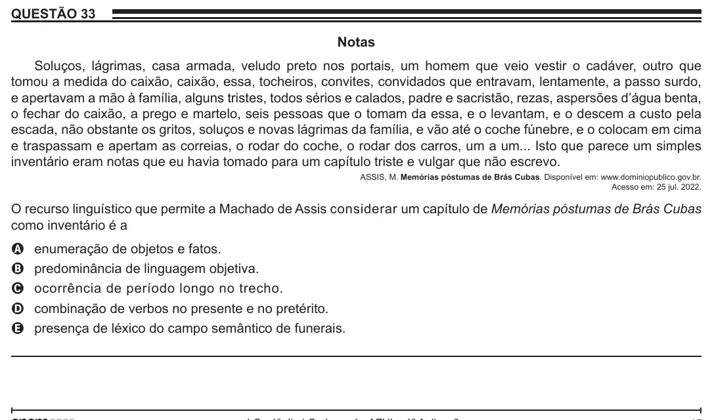

Texto extraído (pode conter ruído)

QUESTÃO 33  
Notas  
Soluços, lágrimas, casa armada, veludo preto nos portais, um homem que veio vestir o cadáver, outro que  
tomou a medida do caixão, caixão, essa, tocheiros, convites, convidados que entravam, lentamente, a passo surdo,  
e apertavam a mão à família, alguns tristes, todos sérios e calados, padre e sacristão, rezas, aspersões d’água benta,  
o fechar do caixão, a prego e martelo, seis pessoas que o tomam da essa, e o levantam, e o descem a custo pela  
escada, não obstante os gritos, soluços e novas lágrimas da família, e vão até o coche fúnebre, e o colocam em cima  
e traspassam e apertam as correias, o rodar do coche, o rodar dos carros, um a um... Isto que parece um simples  
inventário eram notas que eu havia tomado para um capítulo triste e vulgar que não escrevo.  
ASSIS, M. Memórias póstumas de Brás Cubas. Disponível em: www.dominiopublico.gov.br.  
Acesso em: 25 jul. 2022.  
O recurso linguístico que permite a Machado de Assis considerar um capítulo de Memórias póstumas de Brás Cubas  
como inventário é a  
A  
enumeração de objetos e fatos.  
predominância de linguagem objetiva.  
B  
ocorrência de período longo no trecho.  
C  
combinação de verbos no presente e no pretérito.  
D  
presença de léxico do campo semântico de funerais.  
E

