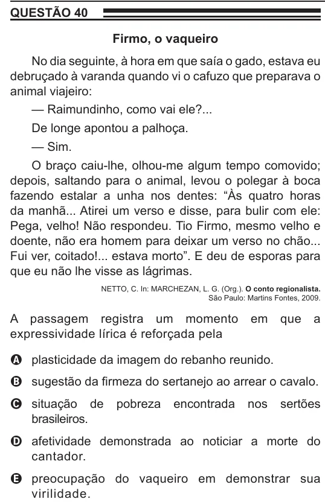

Texto extraído (pode conter ruído)

QUESTÃO 40  
Firmo, o vaqueiro  
No dia seguinte, à hora em que saía o gado, estava eu  
debruçado à varanda quando vi o cafuzo que preparava o  
animal viajeiro:  
— Raimundinho, como vai ele?...  
De longe apontou a palhoça.  
— Sim.  
O braço caiu-lhe, olhou-me algum tempo comovido;  
depois, saltando para o animal, levou o polegar à boca  
fazendo estalar a unha nos dentes: “Às quatro horas  
da manhã... Atirei um verso e disse, para bulir com ele:  
Pega, velho! Não respondeu. Tio Firmo, mesmo velho e  
doente, não era homem para deixar um verso no chão...  
Fui ver, coitado!... estava morto”. E deu de esporas para  
que eu não lhe visse as lágrimas.  
NETTO, C. In: MARCHEZAN, L. G. (Org.). O conto regionalista.  
São Paulo: Martins Fontes, 2009.  
A passagem registra um momento  
em  
que  
a  
expressividade lírica é reforçada pela  
A plasticidade da imagem do rebanho reunido.  
B sugestão da firmeza do sertanejo ao arrear o cavalo.  
C situação de  
pobreza  
encontrada  
nos  
sertões  
brasileiros.  
D afetividade demonstrada ao noticiar a morte do  
cantador.  
E preocupação do vaqueiro em demonstrar sua  
virilidade.

