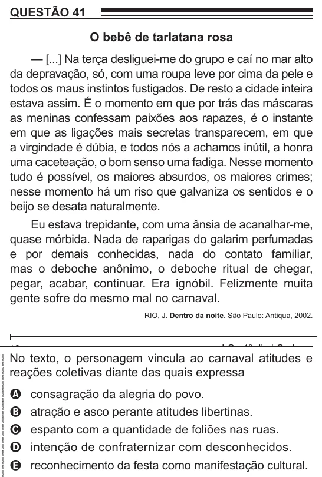

Texto extraído (pode conter ruído)

QUESTÃO 41  
O bebê de tarlatana rosa  
— [...] Na terça desliguei-me do grupo e caí no mar alto  
da depravação, só, com uma roupa leve por cima da pele e  
todos os maus instintos fustigados. De resto a cidade inteira  
estava assim. É o momento em que por trás das máscaras  
as meninas confessam paixões aos rapazes, é o instante  
em que as ligações mais secretas transparecem, em que  
a virgindade é dúbia, e todos nós a achamos inútil, a honra  
uma caceteação, o bom senso uma fadiga. Nesse momento  
tudo é possível, os maiores absurdos, os maiores crimes;  
nesse momento há um riso que galvaniza os sentidos e o  
beijo se desata naturalmente.  
Eu estava trepidante, com uma ânsia de acanalhar-me,  
quase mórbida. Nada de raparigas do galarim perfumadas  
e por demais conhecidas, nada do contato familiar,  
mas o deboche anônimo, o deboche ritual de chegar,  
pegar, acabar, continuar. Era ignóbil. Felizmente muita  
gente sofre do mesmo mal no carnaval.  
RIO, J. Dentro da noite. São Paulo: Antiqua, 2002.  
No texto, o personagem vincula ao carnaval atitudes e  
reações coletivas diante das quais expressa  
consagração da alegria do povo.  
A  
atração e asco perante atitudes libertinas.  
B  
espanto com a quantidade de foliões nas ruas.  
C  
intenção de confraternizar com desconhecidos.  
D  
reconhecimento da festa como manifestação cultural.  
E

