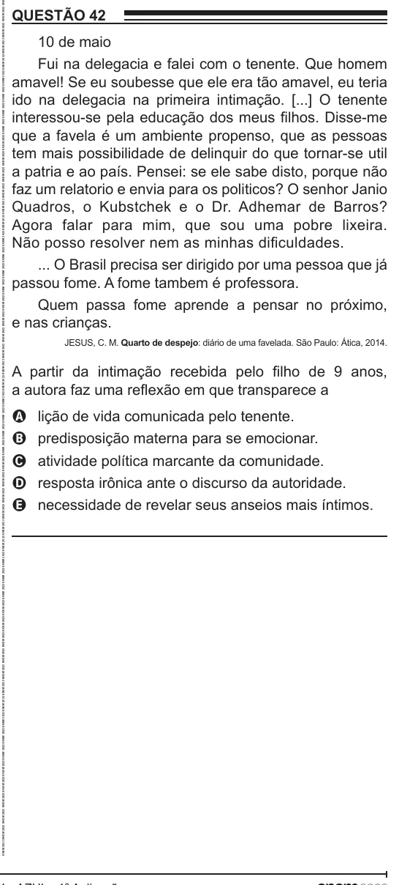

Texto extraído (pode conter ruído)

QUESTÃO 42  
10 de maio  
Fui na delegacia e falei com o tenente. Que homem  
amavel! Se eu soubesse que ele era tão amavel, eu teria  
ido na delegacia na primeira intimação. [...] O tenente  
interessou-se pela educação dos meus filhos. Disse-me  
que a favela é um ambiente propenso, que as pessoas  
tem mais possibilidade de delinquir do que tornar-se util  
a patria e ao país. Pensei: se ele sabe disto, porque não  
faz um relatorio e envia para os politicos? O senhor Janio  
Quadros, o Kubstchek e o Dr. Adhemar de Barros?  
Agora falar para mim, que sou uma pobre lixeira.  
Não posso resolver nem as minhas dificuldades.  
... O Brasil precisa ser dirigido por uma pessoa que já  
passou fome. A fome tambem é professora.  
Quem passa fome aprende a pensar no próximo,  
e nas crianças.  
JESUS, C. M. Quarto de despejo: diário de uma favelada. São Paulo: Ática, 2014.  
A partir da intimação recebida pelo filho de 9 anos,  
a autora faz uma reflexão em que transparece a  
lição de vida comunicada pelo tenente.  
A  
predisposição materna para se emocionar.  
B  
atividade política marcante da comunidade.  
C  
D  
resposta irônica ante o discurso da autoridade.  
necessidade de revelar seus anseios mais íntimos.  
E

