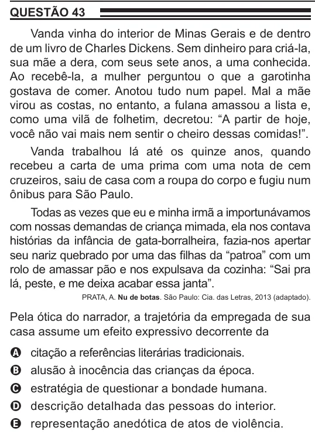

Texto extraído (pode conter ruído)

QUESTÃO 43  
Vanda vinha do interior de Minas Gerais e de dentro  
de um livro de Charles Dickens. Sem dinheiro para criá-la,  
sua mãe a dera, com seus sete anos, a uma conhecida.  
Ao recebê-la, a mulher perguntou o que a garotinha  
gostava de comer. Anotou tudo num papel. Mal a mãe  
virou as costas, no entanto, a fulana amassou a lista e,  
como uma vilã de folhetim, decretou: “A partir de hoje,  
você não vai mais nem sentir o cheiro dessas comidas!”.  
Vanda trabalhou lá até os quinze anos, quando  
recebeu a carta de uma prima com uma nota de cem  
cruzeiros, saiu de casa com a roupa do corpo e fugiu num  
ônibus para São Paulo.  
Todas as vezes que eu e minha irmã a importunávamos  
com nossas demandas de criança mimada, ela nos contava  
histórias da infância de gata-borralheira, fazia-nos apertar  
seu nariz quebrado por uma das filhas da “patroa” com um  
rolo de amassar pão e nos expulsava da cozinha: “Sai pra  
lá, peste, e me deixa acabar essa janta”.  
PRATA, A. Nu de botas. São Paulo: Cia. das Letras, 2013 (adaptado).  
Pela ótica do narrador, a trajetória da empregada de sua  
casa assume um efeito expressivo decorrente da  
citação a referências literárias tradicionais.  
A  
alusão à inocência das crianças da época.  
B  
estratégia de questionar a bondade humana.  
C  
descrição detalhada das pessoas do interior.  
D  
representação anedótica de atos de violência.  
E

