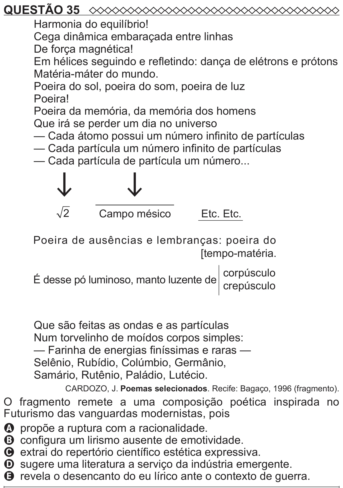

Texto extraído (pode conter ruído)

QUESTÃO 35  
Harmonia do equilíbrio!  
Cega dinâmica embaraçada entre linhas  
De força magnética!  
Em hélices seguindo e refletindo: dança de elétrons e prótons  
Matéria-máter do mundo.  
Poeira do sol, poeira do som, poeira de luz  
Poeira!  
Poeira da memória, da memória dos homens  
Que irá se perder um dia no universo  
— Cada átomo possui um número infinito de partículas  
— Cada partícula um número infinito de partículas  
— Cada partícula de partícula um número...  
2  
Campo mésico  
Etc. Etc.  
Poeira de ausências e lembranças: poeira do  
[tempo-matéria.  
corpúsculo  
É desse pó luminoso, manto luzente de  
crepúsculo  
Que são feitas as ondas e as partículas  
Num torvelinho de moídos corpos simples:  
— Farinha de energias finíssimas e raras —  
Selênio, Rubídio, Colúmbio, Germânio,  
Samário, Rutênio, Paládio, Lutécio.  
CARDOZO, J. Poemas selecionados. Recife: Bagaço, 1996 (fragmento).  
O fragmento remete a uma composição poética inspirada no  
Futurismo das vanguardas modernistas, pois  
A propõe a ruptura com a racionalidade.  
B configura um lirismo ausente de emotividade.  
C extrai do repertório científico estética expressiva.  
D sugere uma literatura a serviço da indústria emergente.  
E revela o desencanto do eu lírico ante o contexto de guerra.

