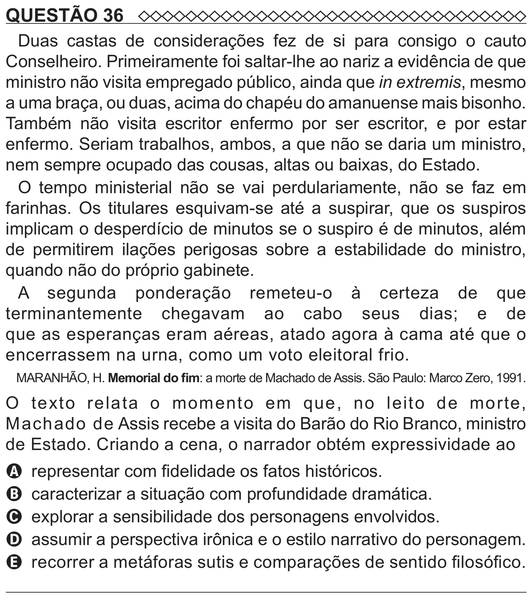

Texto extraído (pode conter ruído)

QUESTÃO 36  
Duas castas de considerações fez de si para consigo o cauto  
Conselheiro. Primeiramente foi saltar-lhe ao nariz a evidência de que  
ministro não visita empregado público, ainda que in extremis, mesmo  
a uma braça, ou duas, acima do chapéu do amanuense mais bisonho.  
Também não visita escritor enfermo por ser escritor, e por estar  
enfermo. Seriam trabalhos, ambos, a que não se daria um ministro,  
nem sempre ocupado das cousas, altas ou baixas, do Estado.  
O tempo ministerial não se vai perdulariamente, não se faz em  
farinhas. Os titulares esquivam-se até a suspirar, que os suspiros  
implicam o desperdício de minutos se o suspiro é de minutos, além  
de permitirem ilações perigosas sobre a estabilidade do ministro,  
quando não do próprio gabinete.  
A segunda ponderação remeteu-o à certeza de que  
terminantemente chegavam ao cabo seus dias; e de  
que as esperanças eram aéreas, atado agora à cama até que o  
encerrassem na urna, como um voto eleitoral frio.  
MARANHÃO, H. Memorial do fim: a morte de Machado de Assis. São Paulo: Marco Zero, 1991.  
O texto relata o momento em que, no leito de morte,  
Machado de Assis recebe a visita do Barão do Rio Branco, ministro  
de Estado. Criando a cena, o narrador obtém expressividade ao  
A representar com fidelidade os fatos históricos.  
B caracterizar a situação com profundidade dramática.  
C explorar a sensibilidade dos personagens envolvidos.  
D assumir a perspectiva irônica e o estilo narrativo do personagem.  
E recorrer a metáforas sutis e comparações de sentido filosófico.

