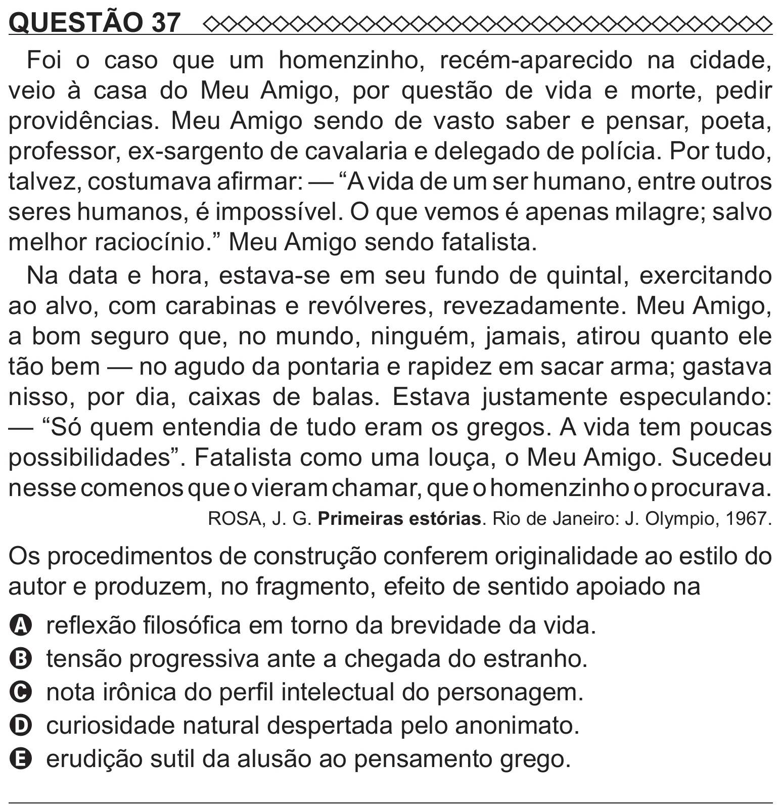

Texto extraído (pode conter ruído)

QUESTÃO 37  
Foi o caso que um homenzinho, recém-aparecido na cidade,  
veio à casa do Meu Amigo, por questão de vida e morte, pedir  
providências. Meu Amigo sendo de vasto saber e pensar, poeta,  
professor, ex-sargento de cavalaria e delegado de polícia. Por tudo,  
talvez, costumava afirmar: — “A vida de um ser humano, entre outros  
seres humanos, é impossível. O que vemos é apenas milagre; salvo  
melhor raciocínio.” Meu Amigo sendo fatalista.  
Na data e hora, estava-se em seu fundo de quintal, exercitando  
ao alvo, com carabinas e revólveres, revezadamente. Meu Amigo,  
a bom seguro que, no mundo, ninguém, jamais, atirou quanto ele  
tão bem — no agudo da pontaria e rapidez em sacar arma; gastava  
nisso, por dia, caixas de balas. Estava justamente especulando:  
— “Só quem entendia de tudo eram os gregos. A vida tem poucas  
possibilidades”. Fatalista como uma louça, o Meu Amigo. Sucedeu  
nesse comenos que o vieram chamar, que o homenzinho o procurava.  
ROSA, J. G. Primeiras estórias. Rio de Janeiro: J. Olympio, 1967.  
Os procedimentos de construção conferem originalidade ao estilo do  
autor e produzem, no fragmento, efeito de sentido apoiado na  
A reflexão filosófica em torno da brevidade da vida.  
B tensão progressiva ante a chegada do estranho.  
C nota irônica do perfil intelectual do personagem.  
D curiosidade natural despertada pelo anonimato.  
E erudição sutil da alusão ao pensamento grego.

