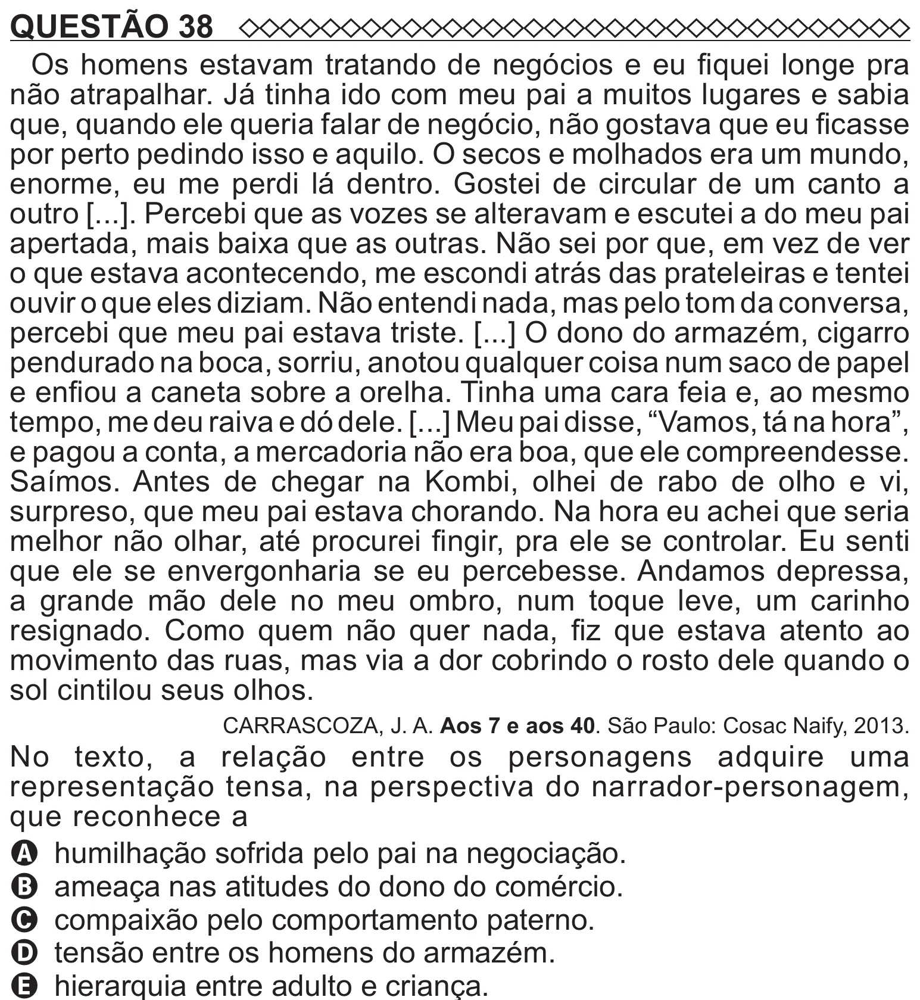

Texto extraído (pode conter ruído)

QUESTÃO 38  
Os homens estavam tratando de negócios e eu fiquei longe pra  
não atrapalhar. Já tinha ido com meu pai a muitos lugares e sabia  
que, quando ele queria falar de negócio, não gostava que eu ficasse  
por perto pedindo isso e aquilo. O secos e molhados era um mundo,  
enorme, eu me perdi lá dentro. Gostei de circular de um canto a  
outro [...]. Percebi que as vozes se alteravam e escutei a do meu pai  
apertada, mais baixa que as outras. Não sei por que, em vez de ver  
o que estava acontecendo, me escondi atrás das prateleiras e tentei  
ouvir o que eles diziam. Não entendi nada, mas pelo tom da conversa,  
percebi que meu pai estava triste. [...] O dono do armazém, cigarro  
pendurado na boca, sorriu, anotou qualquer coisa num saco de papel  
e enfiou a caneta sobre a orelha. Tinha uma cara feia e, ao mesmo  
tempo, me deu raiva e dó dele. [...] Meu pai disse, “Vamos, tá na hora”,  
e pagou a conta, a mercadoria não era boa, que ele compreendesse.  
Saímos. Antes de chegar na Kombi, olhei de rabo de olho e vi,  
surpreso, que meu pai estava chorando. Na hora eu achei que seria  
melhor não olhar, até procurei fingir, pra ele se controlar. Eu senti  
que ele se envergonharia se eu percebesse. Andamos depressa,  
a grande mão dele no meu ombro, num toque leve, um carinho  
resignado. Como quem não quer nada, fiz que estava atento ao  
movimento das ruas, mas via a dor cobrindo o rosto dele quando o  
sol cintilou seus olhos.  
CARRASCOZA, J. A. Aos 7 e aos 40. São Paulo: Cosac Naify, 2013.  
No texto, a relação entre os personagens adquire uma  
representação tensa, na perspectiva do narrador-personagem,  
que reconhece a  
A humilhação sofrida pelo pai na negociação.  
B ameaça nas atitudes do dono do comércio.  
C compaixão pelo comportamento paterno.  
D tensão entre os homens do armazém.

