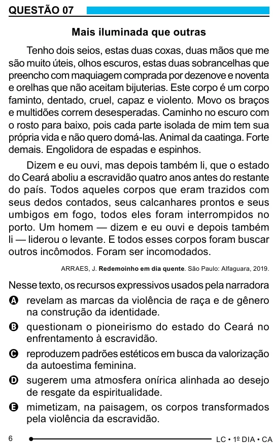

Texto extraído (pode conter ruído)

QUESTÃO 07  
Mais iluminada que outras  
Tenho dois seios, estas duas coxas, duas mãos que me  
são muito úteis, olhos escuros, estas duas sobrancelhas que  
preencho com maquiagem comprada por dezenove e noventa  
e orelhas que não aceitam bijuterias. Este corpo é um corpo  
faminto, dentado, cruel, capaz e violento. Movo os braços  
e multidões correm desesperadas. Caminho no escuro com  
o rosto para baixo, pois cada parte isolada de mim tem sua  
própria vida e não quero domá-las. Animal da caatinga. Forte  
demais. Engolidora de espadas e espinhos.  
Dizem e eu ouvi, mas depois também li, que o estado  
do Ceará aboliu a escravidão quatro anos antes do restante  
do país. Todos aqueles corpos que eram trazidos com  
seus dedos contados, seus calcanhares prontos e seus  
umbigos em fogo, todos eles foram interrompidos no  
porto. Um homem — dizem e eu ouvi e depois também  
li — liderou o levante. E todos esses corpos foram buscar  
outros incômodos. Foram ser incomodados.  
ARRAES, J. Redemoinho em dia quente. São Paulo: Alfaguara, 2019.  
Nesse texto, os recursos expressivos usados pela narradora  
A revelam as marcas da violência de raça e de gênero  
na construção da identidade.  
B questionam o pioneirismo do estado do Ceará no  
enfrentamento à escravidão.  
C reproduzem padrões estéticos em busca da valorização  
da autoestima feminina.  
D sugerem uma atmosfera onírica alinhada ao desejo  
de resgate da espiritualidade.  
E mimetizam, na paisagem, os corpos transformados  
pela violência da escravidão.  
6

