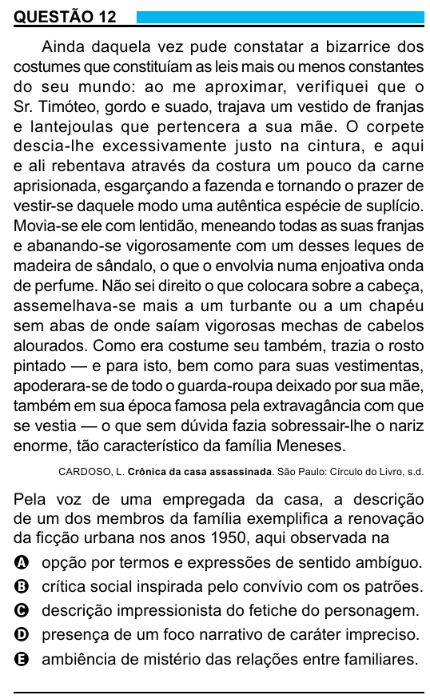

Texto extraído (pode conter ruído)

QUESTÃO 12  
Ainda daquela vez pude constatar a bizarrice dos  
costumes que constituíam as leis mais ou menos constantes  
do seu mundo: ao me aproximar, verifiquei que o  
Sr. Timóteo, gordo e suado, trajava um vestido de franjas  
e lantejoulas que pertencera a sua mãe. O corpete  
descia-lhe excessivamente justo na cintura, e aqui  
e ali rebentava através da costura um pouco da carne  
aprisionada, esgarçando a fazenda e tornando o prazer de  
vestir-se daquele modo uma autêntica espécie de suplício.  
Movia-se ele com lentidão, meneando todas as suas franjas  
e abanando-se vigorosamente com um desses leques de  
madeira de sândalo, o que o envolvia numa enjoativa onda  
de perfume. Não sei direito o que colocara sobre a cabeça,  
assemelhava-se mais a um turbante ou a um chapéu  
sem abas de onde saíam vigorosas mechas de cabelos  
alourados. Como era costume seu também, trazia o rosto  
pintado — e para isto, bem como para suas vestimentas,  
apoderara-se de todo o guarda-roupa deixado por sua mãe,  
também em sua época famosa pela extravagância com que  
se vestia — o que sem dúvida fazia sobressair-lhe o nariz  
enorme, tão característico da família Meneses.  
CARDOSO, L. Crônica da casa assassinada. São Paulo: Círculo do Livro, s.d.  
Pela voz de uma empregada da casa, a descrição  
de um dos membros da família exemplifica a renovação  
da ficção urbana nos anos 1950, aqui observada na  
A opção por termos e expressões de sentido ambíguo.  
B crítica social inspirada pelo convívio com os patrões.  
C descrição impressionista do fetiche do personagem.  
D presença de um foco narrativo de caráter impreciso.  
E ambiência de mistério das relações entre familiares.  
8

