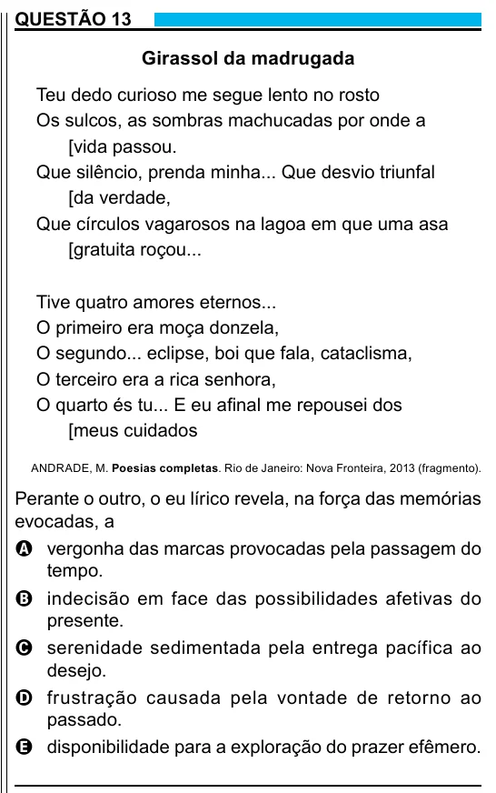

Texto extraído (pode conter ruído)

QUESTÃO 13  
Girassol da madrugada  
Teu dedo curioso me segue lento no rosto  
Os sulcos, as sombras machucadas por onde a  
[vida passou.  
Que silêncio, prenda minha... Que desvio triunfal  
[da verdade,  
Que círculos vagarosos na lagoa em que uma asa  
[gratuita roçou...  
Tive quatro amores eternos...  
O primeiro era moça donzela,  
O segundo... eclipse, boi que fala, cataclisma,  
O terceiro era a rica senhora,  
O quarto és tu... E eu afinal me repousei dos  
[meus cuidados  
ANDRADE, M. Poesias completas. Rio de Janeiro: Nova Fronteira, 2013 (fragmento).  
Perante o outro, o eu lírico revela, na força das memórias  
evocadas, a  
A vergonha das marcas provocadas pela passagem do  
tempo.  
B indecisão em face das possibilidades afetivas do  
presente.  
C serenidade sedimentada pela entrega pacífica ao  
desejo.  
D frustração causada pela vontade de retorno ao  
passado.  
E disponibilidade para a exploração do prazer efêmero.

