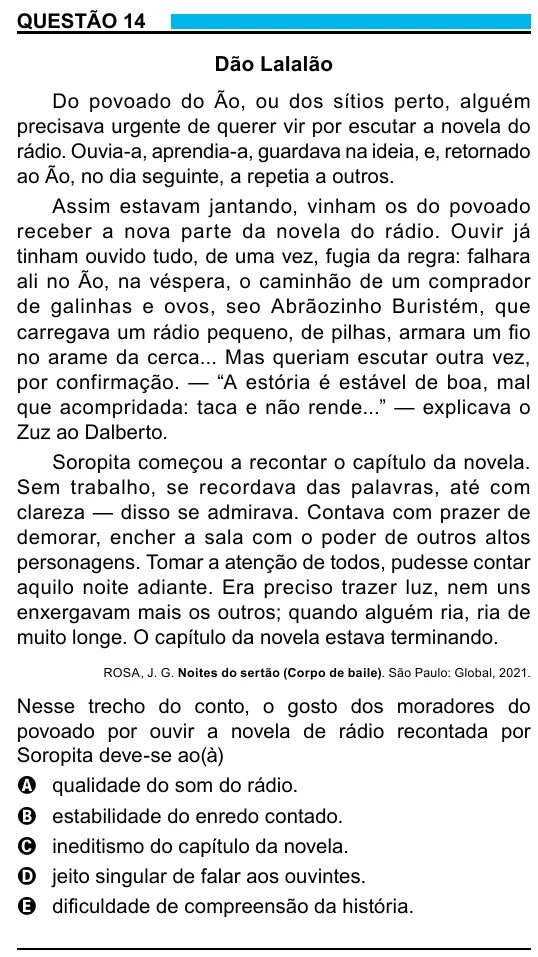

Texto extraído (pode conter ruído)

QUESTÃO 14  
Dão Lalalão  
Do povoado do Ão, ou dos sítios perto, alguém  
precisava urgente de querer vir por escutar a novela do  
rádio. Ouvia-a, aprendia-a, guardava na ideia, e, retornado  
ao Ão, no dia seguinte, a repetia a outros.  
Assim estavam jantando, vinham os do povoado  
receber a nova parte da novela do rádio. Ouvir já  
tinham ouvido tudo, de uma vez, fugia da regra: falhara  
ali no Ão, na véspera, o caminhão de um comprador  
de galinhas e ovos, seo Abrãozinho Buristém, que  
carregava um rádio pequeno, de pilhas, armara um fio  
no arame da cerca... Mas queriam escutar outra vez,  
por confirmação. — “A estória é estável de boa, mal  
que acompridada: taca e não rende...” — explicava o  
Zuz ao Dalberto.  
Soropita começou a recontar o capítulo da novela.  
Sem trabalho, se recordava das palavras, até com  
clareza — disso se admirava. Contava com prazer de  
demorar, encher a sala com o poder de outros altos  
personagens. Tomar a atenção de todos, pudesse contar  
aquilo noite adiante. Era preciso trazer luz, nem uns  
enxergavam mais os outros; quando alguém ria, ria de  
muito longe. O capítulo da novela estava terminando.  
ROSA, J. G. Noites do sertão (Corpo de baile). São Paulo: Global, 2021.  
Nesse trecho do conto, o gosto dos moradores do  
povoado por ouvir a novela de rádio recontada por  
Soropita deve-se ao(à)  
A qualidade do som do rádio.  
B estabilidade do enredo contado.  
C ineditismo do capítulo da novela.  
D jeito singular de falar aos ouvintes.  
E dificuldade de compreensão da história.

