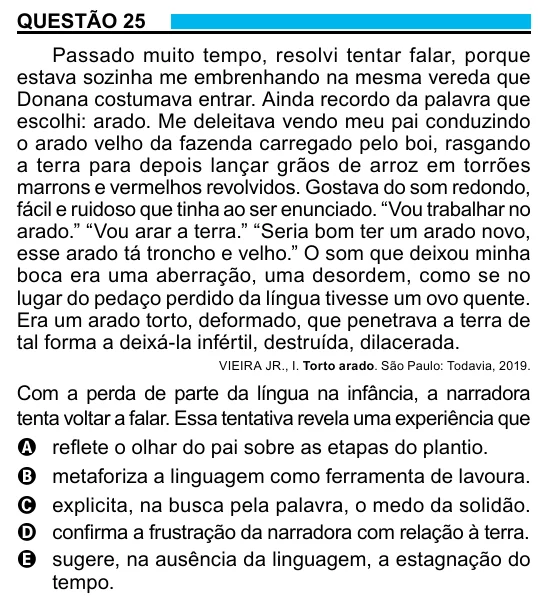

Texto extraído (pode conter ruído)

QUESTÃO 25  
Passado muito tempo, resolvi tentar falar, porque  
estava sozinha me embrenhando na mesma vereda que  
Donana costumava entrar. Ainda recordo da palavra que  
escolhi: arado. Me deleitava vendo meu pai conduzindo  
o arado velho da fazenda carregado pelo boi, rasgando  
a terra para depois lançar grãos de arroz em torrões  
marrons e vermelhos revolvidos. Gostava do som redondo,  
fácil e ruidoso que tinha ao ser enunciado. “Vou trabalhar no  
arado.” “Vou arar a terra.” “Seria bom ter um arado novo,  
esse arado tá troncho e velho.” O som que deixou minha  
boca era uma aberração, uma desordem, como se no  
lugar do pedaço perdido da língua tivesse um ovo quente.  
Era um arado torto, deformado, que penetrava a terra de  
tal forma a deixá-la infértil, destruída, dilacerada.  
VIEIRA JR., I. Torto arado. São Paulo: Todavia, 2019.  
Com a perda de parte da língua na infância, a narradora  
tenta voltar a falar. Essa tentativa revela uma experiência que  
A reflete o olhar do pai sobre as etapas do plantio.  
B metaforiza a linguagem como ferramenta de lavoura.  
C explicita, na busca pela palavra, o medo da solidão.  
D confirma a frustração da narradora com relação à terra.  
E sugere, na ausência da linguagem, a estagnação do  
tempo.

