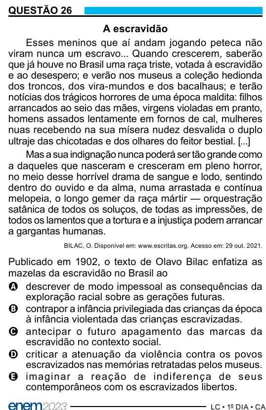

Texto extraído (pode conter ruído)

QUESTÃO 26  
A escravidão  
Esses meninos que aí andam jogando peteca não  
viram nunca um escravo... Quando crescerem, saberão  
que já houve no Brasil uma raça triste, votada à escravidão  
e ao desespero; e verão nos museus a coleção hedionda  
dos troncos, dos vira-mundos e dos bacalhaus; e terão  
notícias dos trágicos horrores de uma época maldita: filhos  
arrancados ao seio das mães, virgens violadas em pranto,  
homens assados lentamente em fornos de cal, mulheres  
nuas recebendo na sua mísera nudez desvalida o duplo  
ultraje das chicotadas e dos olhares do feitor bestial. [...]  
Mas a sua indignação nunca poderá ser tão grande como  
a daqueles que nasceram e cresceram em pleno horror,  
no meio desse horrível drama de sangue e lodo, sentindo  
dentro do ouvido e da alma, numa arrastada e contínua  
melopeia, o longo gemer da raça mártir — orquestração  
satânica de todos os soluços, de todas as impressões, de  
todos os lamentos que a tortura e a injustiça podem arrancar  
a gargantas humanas.  
BILAC, O. Disponível em: www.escritas.org. Acesso em: 29 out. 2021.  
Publicado em 1902, o texto de Olavo Bilac enfatiza as  
mazelas da escravidão no Brasil ao  
A descrever de modo impessoal as consequências da  
exploração racial sobre as gerações futuras.  
B contrapor a infância privilegiada das crianças da época  
à infância violentada das crianças escravizadas.  
C antecipar o futuro apagamento das marcas da  
escravidão no contexto social.  
D criticar a atenuação da violência contra os povos  
escravizados nas memórias retratadas pelos museus.  
E imaginar a reaç ão de indiferenç a de seus  
contemporâneos com os escravizados libertos.

