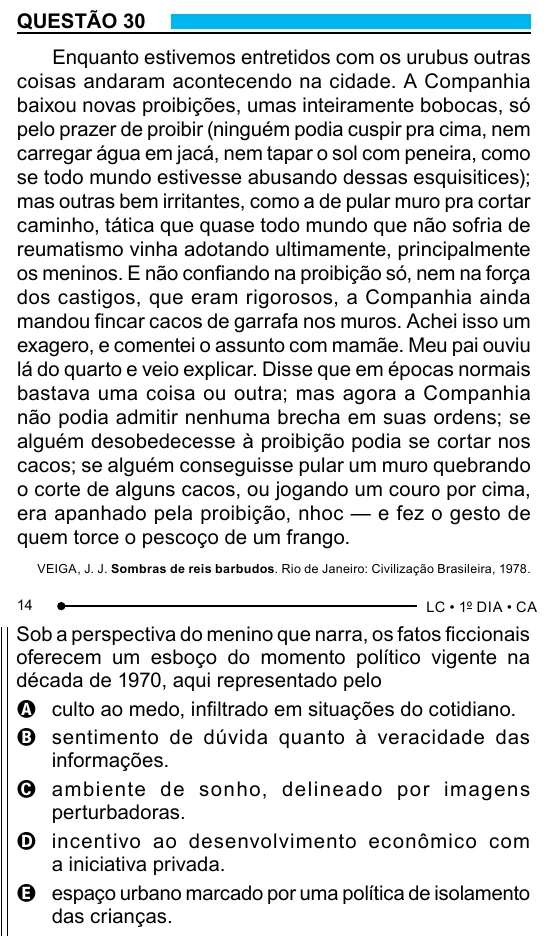

Texto extraído (pode conter ruído)

QUESTÃO 30  
Enquanto estivemos entretidos com os urubus outras  
coisas andaram acontecendo na cidade. A Companhia  
baixou novas proibições, umas inteiramente bobocas, só  
pelo prazer de proibir (ninguém podia cuspir pra cima, nem  
carregar água em jacá, nem tapar o sol com peneira, como  
se todo mundo estivesse abusando dessas esquisitices);  
mas outras bem irritantes, como a de pular muro pra cortar  
caminho, tática que quase todo mundo que não sofria de  
reumatismo vinha adotando ultimamente, principalmente  
os meninos. E não confiando na proibição só, nem na força  
dos castigos, que eram rigorosos, a Companhia ainda  
mandou fincar cacos de garrafa nos muros. Achei isso um  
exagero, e comentei o assunto com mamãe. Meu pai ouviu  
lá do quarto e veio explicar. Disse que em épocas normais  
bastava uma coisa ou outra; mas agora a Companhia  
não podia admitir nenhuma brecha em suas ordens; se  
alguém desobedecesse à proibição podia se cortar nos  
cacos; se alguém conseguisse pular um muro quebrando  
o corte de alguns cacos, ou jogando um couro por cima,  
era apanhado pela proibição, nhoc — e fez o gesto de  
quem torce o pescoço de um frango.  
VEIGA, J. J. Sombras de reis barbudos. Rio de Janeiro: Civilização Brasileira, 1978.  
14  
Sob a perspectiva do menino que narra, os fatos ficcionais  
oferecem um esboço do momento político vigente na  
década de 1970, aqui representado pelo  
A culto ao medo, infiltrado em situações do cotidiano.  
B sentimento de dúvida quanto à veracidade das  
informações.  
C ambiente de sonho, delineado por imagens  
perturbadoras.  
D incentivo ao desenvolvimento econômico com  
a iniciativa privada.  
E espaço urbano marcado por uma política de isolamento  
das crianças.

