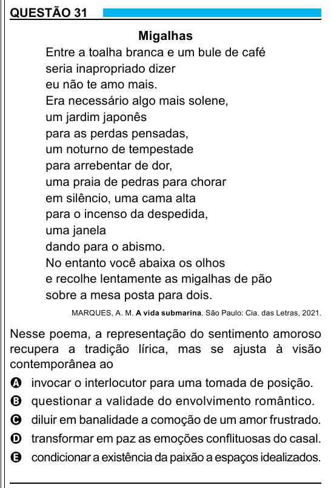

Texto extraído (pode conter ruído)

QUESTÃO 31  
Migalhas  
Entre a toalha branca e um bule de café  
seria inapropriado dizer  
eu não te amo mais.  
Era necessário algo mais solene,  
um jardim japonês  
para as perdas pensadas,  
um noturno de tempestade  
para arrebentar de dor,  
uma praia de pedras para chorar  
em silêncio, uma cama alta  
para o incenso da despedida,  
uma janela  
dando para o abismo.  
No entanto você abaixa os olhos  
e recolhe lentamente as migalhas de pão  
sobre a mesa posta para dois.  
MARQUES, A. M. A vida submarina. São Paulo: Cia. das Letras, 2021.  
Nesse poema, a representação do sentimento amoroso  
recupera a tradição lírica, mas se ajusta à visão  
contemporânea ao  
A invocar o interlocutor para uma tomada de posição.  
B questionar a validade do envolvimento romântico.  
C diluir em banalidade a comoção de um amor frustrado.  
D transformar em paz as emoções conflituosas do casal.  
E condicionar a existência da paixão a espaços idealizados.

