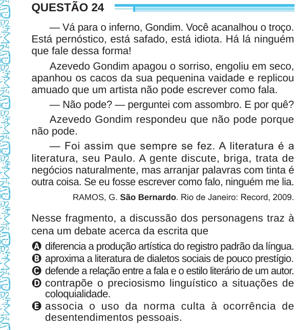

Texto extraído (pode conter ruído)

QUESTÃO 24  
— Vá para o inferno, Gondim. Você acanalhou o troço.  
Está pernóstico, está safado, está idiota. Há lá ninguém  
que fale dessa forma!  
Azevedo Gondim apagou o sorriso, engoliu em seco,  
apanhou os cacos da sua pequenina vaidade e replicou  
amuado que um artista não pode escrever como fala.  
— Não pode? — perguntei com assombro. E por quê?  
Azevedo Gondim respondeu que não pode porque  
não pode.  
— Foi assim que sempre se fez. A literatura é a  
literatura, seu Paulo. A gente discute, briga, trata de  
negócios naturalmente, mas arranjar palavras com tinta é  
outra coisa. Se eu fosse escrever como falo, ninguém me lia.  
RAMOS, G. São Bernardo. Rio de Janeiro: Record, 2009.  
Nesse fragmento, a discussão dos personagens traz à  
cena um debate acerca da escrita que  
A diferencia a produção artística do registro padrão da língua.  
B aproxima a literatura de dialetos sociais de pouco prestígio.  
C defende a relação entre a fala e o estilo literário de um autor.  
D contrapõe o preciosismo linguístico a situações de  
coloquialidade.  
E associa o uso da norma culta à ocorrência de  
desentendimentos pessoais.

