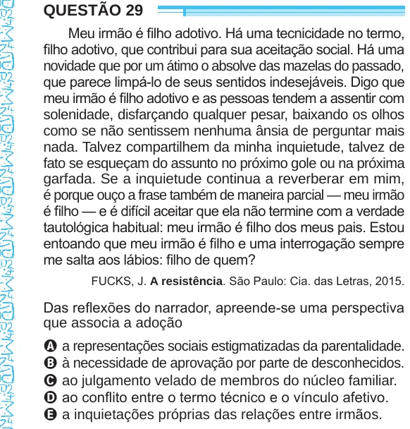

Texto extraído (pode conter ruído)

QUESTÃO 29  
Meu irmão é filho adotivo. Há uma tecnicidade no termo,  
filho adotivo, que contribui para sua aceitação social. Há uma  
novidade que por um átimo o absolve das mazelas do passado,  
que parece limpá-lo de seus sentidos indesejáveis. Digo que  
meu irmão é filho adotivo e as pessoas tendem a assentir com  
solenidade, disfarçando qualquer pesar, baixando os olhos  
como se não sentissem nenhuma ânsia de perguntar mais  
nada. Talvez compartilhem da minha inquietude, talvez de  
fato se esqueçam do assunto no próximo gole ou na próxima  
garfada. Se a inquietude continua a reverberar em mim,  
é porque ouço a frase também de maneira parcial — meu irmão  
é filho — e é difícil aceitar que ela não termine com a verdade  
tautológica habitual: meu irmão é filho dos meus pais. Estou  
entoando que meu irmão é filho e uma interrogação sempre  
me salta aos lábios: filho de quem?  
FUCKS, J. A resistência. São Paulo: Cia. das Letras, 2015.  
Das reflexões do narrador, apreende-se uma perspectiva  
que associa a adoção  
A a representações sociais estigmatizadas da parentalidade.  
B à necessidade de aprovação por parte de desconhecidos.  
C ao julgamento velado de membros do núcleo familiar.  
D ao conflito entre o termo técnico e o vínculo afetivo.  
E a inquietações próprias das relações entre irmãos.

