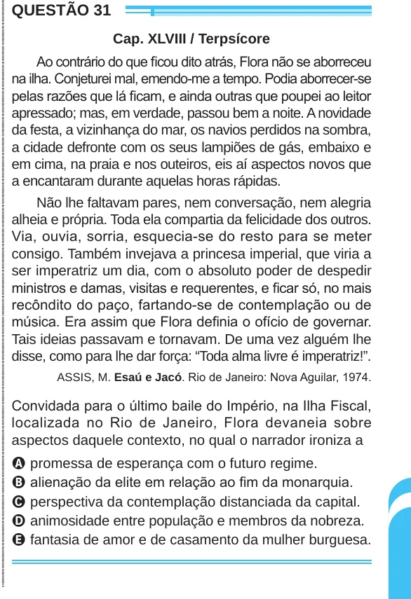

Texto extraído (pode conter ruído)

QUESTÃO 31  
Cap. XLVIII / Terpsícore  
Ao contrário do que ficou dito atrás, Flora não se aborreceu  
na ilha. Conjeturei mal, emendo-me a tempo. Podia aborrecer-se  
pelas razões que lá ficam, e ainda outras que poupei ao leitor  
apressado; mas, em verdade, passou bem a noite. A novidade  
da festa, a vizinhança do mar, os navios perdidos na sombra,  
a cidade defronte com os seus lampiões de gás, embaixo e  
em cima, na praia e nos outeiros, eis aí aspectos novos que  
a encantaram durante aquelas horas rápidas.  
Não lhe faltavam pares, nem conversação, nem alegria  
alheia e própria. Toda ela compartia da felicidade dos outros.  
Via, ouvia, sorria, esquecia-se do resto para se meter  
consigo. Também invejava a princesa imperial, que viria a  
ser imperatriz um dia, com o absoluto poder de despedir  
ministros e damas, visitas e requerentes, e ficar só, no mais  
recôndito do paço, fartando-se de contemplação ou de  
música. Era assim que Flora definia o ofício de governar.  
Tais ideias passavam e tornavam. De uma vez alguém lhe  
disse, como para lhe dar força: “Toda alma livre é imperatriz!”.  
ASSIS, M. Esaú e Jacó. Rio de Janeiro: Nova Aguilar, 1974.  
Convidada para o último baile do Império, na Ilha Fiscal,  
localizada no Rio de Janeiro, Flora devaneia sobre  
aspectos daquele contexto, no qual o narrador ironiza a  
A promessa de esperança com o futuro regime.  
B alienação da elite em relação ao fim da monarquia.  
C perspectiva da contemplação distanciada da capital.  
D animosidade entre população e membros da nobreza.  
E fantasia de amor e de casamento da mulher burguesa.

