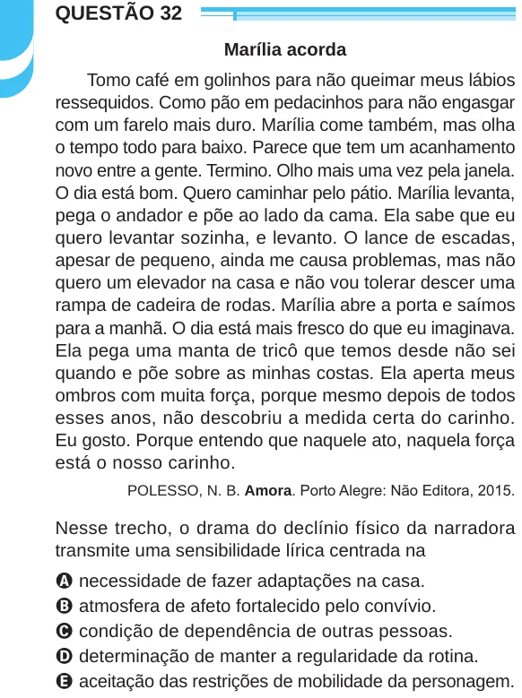

Texto extraído (pode conter ruído)

QUESTÃO 32  
Marília acorda  
Tomo café em golinhos para não queimar meus lábios  
ressequidos. Como pão em pedacinhos para não engasgar  
com um farelo mais duro. Marília come também, mas olha  
o tempo todo para baixo. Parece que tem um acanhamento  
novo entre a gente. Termino. Olho mais uma vez pela janela.  
O dia está bom. Quero caminhar pelo pátio. Marília levanta,  
pega o andador e põe ao lado da cama. Ela sabe que eu  
quero levantar sozinha, e levanto. O lance de escadas,  
apesar de pequeno, ainda me causa problemas, mas não  
quero um elevador na casa e não vou tolerar descer uma  
rampa de cadeira de rodas. Marília abre a porta e saímos  
para a manhã. O dia está mais fresco do que eu imaginava.  
Ela pega uma manta de tricô que temos desde não sei  
quando e põe sobre as minhas costas. Ela aperta meus  
ombros com muita força, porque mesmo depois de todos  
esses anos, não descobriu a medida certa do carinho.  
Eu gosto. Porque entendo que naquele ato, naquela força  
está o nosso carinho.  
POLESSO, N. B. Amora. Porto Alegre: Não Editora, 2015.  
Nesse trecho, o drama do declínio físico da narradora  
transmite uma sensibilidade lírica centrada na  
A necessidade de fazer adaptações na casa.  
B atmosfera de afeto fortalecido pelo convívio.  
C condição de dependência de outras pessoas.  
D determinação de manter a regularidade da rotina.  
E aceitação das restrições de mobilidade da personagem.

