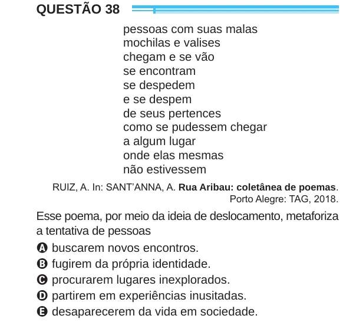

Texto extraído (pode conter ruído)

QUESTÃO 38  
pessoas com suas malas  
mochilas e valises  
chegam e se vão  
se encontram  
se despedem  
e se despem  
de seus pertences  
como se pudessem chegar  
a algum lugar  
onde elas mesmas  
não estivessem  
RUIZ, A. In: SANT’ANNA, A. Rua Aribau: coletânea de poemas.  
Porto Alegre: TAG, 2018.  
Esse poema, por meio da ideia de deslocamento, metaforiza  
a tentativa de pessoas  
A buscarem novos encontros.  
B fugirem da própria identidade.  
C procurarem lugares inexplorados.  
D partirem em experiências inusitadas.  
E desaparecerem da vida em sociedade.

