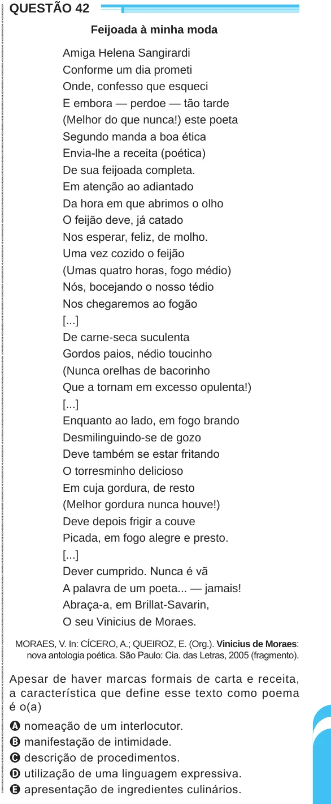

Texto extraído (pode conter ruído)

ENEM2024ENEM2024ENEM2024ENEM2024ENEM2024ENEM2024ENEM2024ENEM2024ENEM2024ENEM2024ENEM2024ENEM2024ENEM2024ENEM2024ENEM2024ENEM2024ENEM2024ENEM2024ENEM2024ENEM2024ENEM2024ENEM2024ENEM2024ENEM2024ENEM2024ENEM2024ENEM2024ENEM2024ENEM2024ENEM2024ENEM2024ENEM2024ENEM2024ENEM2024ENEM2024ENEM2024ENEM2024ENEM2024ENEM2024ENEM2024ENEM2024ENEM2024ENEM2024ENEM2024ENEM2024ENEM2024ENEM2024ENEM2024ENEM2024ENEM2024ENEM2024ENEM2024ENEM2024ENEM2024ENEM2024ENEM2024ENEM2024ENEM2024ENEM2024ENEM2024ENEM2024ENEM2024ENEM2024ENEM2024ENEM2024ENEM2024ENEM2024ENEM2024ENEM2024ENEM2024ENEM2024ENEM2024ENEM2024ENEM2024ENEM2024  
QUESTÃO 42  
Feijoada à minha moda  
Amiga Helena Sangirardi  
Conforme um dia prometi  
Onde, confesso que esqueci  
E embora — perdoe — tão tarde  
(Melhor do que nunca!) este poeta  
Segundo manda a boa ética  
Envia-lhe a receita (poética)  
De sua feijoada completa.  
Em atenção ao adiantado  
Da hora em que abrimos o olho  
O feijão deve, já catado  
Nos esperar, feliz, de molho.  
Uma vez cozido o feijão  
(Umas quatro horas, fogo médio)  
Nós, bocejando o nosso tédio  
Nos chegaremos ao fogão  
[...]  
De carne-seca suculenta  
Gordos paios, nédio toucinho  
(Nunca orelhas de bacorinho  
Que a tornam em excesso opulenta!)  
[...]  
Enquanto ao lado, em fogo brando  
Desmilinguindo-se de gozo  
Deve também se estar fritando  
O torresminho delicioso  
Em cuja gordura, de resto  
(Melhor gordura nunca houve!)  
Deve depois frigir a couve  
Picada, em fogo alegre e presto.  
[...]  
Dever cumprido. Nunca é vã  
A palavra de um poeta... — jamais!  
Abraça-a, em Brillat-Savarin,  
O seu Vinicius de Moraes.  
MORAES, V. In: CÍCERO, A.; QUEIROZ, E. (Org.). Vinicius de Moraes:  
nova antologia poética. São Paulo: Cia. das Letras, 2005 (fragmento).  
Apesar de haver marcas formais de carta e receita,  
a característica que define esse texto como poema  
é o(a)  
A nomeação de um interlocutor.  
B manifestação de intimidade.  
C descrição de procedimentos.  
D utilização de uma linguagem expressiva.  
E apresentação de ingredientes culinários.

