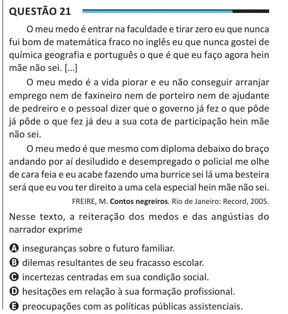

Texto extraído (pode conter ruído)

Questão 21  
O meu medo é entrar na faculdade e tirar zero eu que nunca  
fui bom de matemática fraco no inglês eu que nunca gostei de  
química geografia e português o que é que eu faço agora hein  
mãe não sei. [...]  
O meu medo é a vida piorar e eu não conseguir arranjar  
emprego nem de faxineiro nem de porteiro nem de ajudante  
de pedreiro e o pessoal dizer que o governo já fez o que pôde  
já pôde o que fez já deu a sua cota de participação hein mãe  
não sei.  
O meu medo é que mesmo com diploma debaixo do braço  
andando por aí desiludido e desempregado o policial me olhe  
de cara feia e eu acabe fazendo uma burrice sei lá uma besteira  
será que eu vou ter direito a uma cela especial hein mãe não sei.  
FREIRE, M. Contos negreiros. Rio de Janeiro: Record, 2005.  
Nesse texto, a reiteração dos medos e das angústias do  
narrador exprime  
A inseguranças sobre o futuro familiar.  
B dilemas resultantes de seu fracasso escolar.  
C incertezas centradas em sua condição social.  
D hesitações em relação à sua formação profissional.  
E preocupações com as políticas públicas assistenciais.

