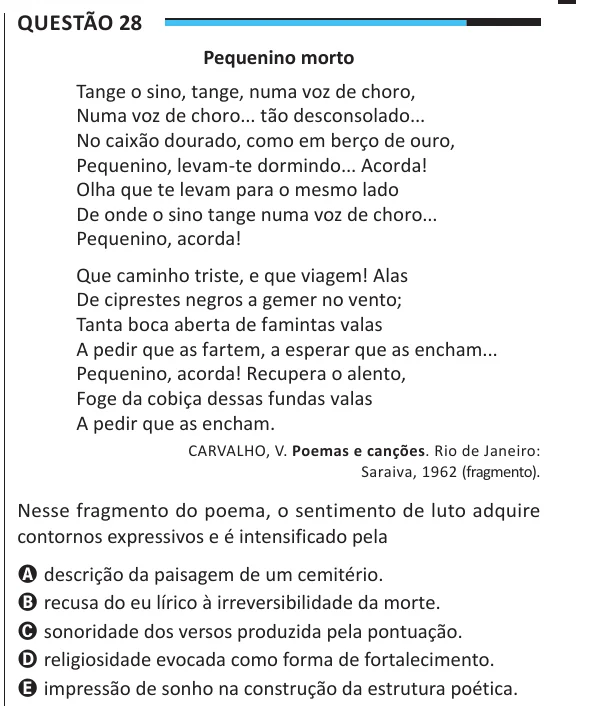

Texto extraído (pode conter ruído)

Questão 28  
Pequenino morto  
Tange o sino, tange, numa voz de choro,  
Numa voz de choro... tão desconsolado...  
No caixão dourado, como em berço de ouro,  
Pequenino, levam-te dormindo... Acorda!  
Olha que te levam para o mesmo lado  
De onde o sino tange numa voz de choro...  
Pequenino, acorda!  
Que caminho triste, e que viagem! Alas  
De ciprestes negros a gemer no vento;  
Tanta boca aberta de famintas valas  
A pedir que as fartem, a esperar que as encham...  
Pequenino, acorda! Recupera o alento,  
Foge da cobiça dessas fundas valas  
A pedir que as encham.  
CARVALHO, V. Poemas e canções. Rio de Janeiro:  
Saraiva, 1962 (fragmento).  
Nesse fragmento do poema, o sentimento de luto adquire  
contornos expressivos e é intensificado pela  
A descrição da paisagem de um cemitério.  
B recusa do eu lírico à irreversibilidade da morte.  
C sonoridade dos versos produzida pela pontuação.  
D religiosidade evocada como forma de fortalecimento.  
E impressão de sonho na construção da estrutura poética.

