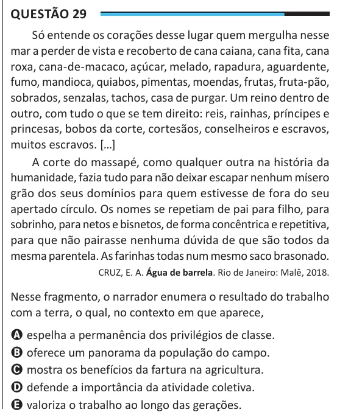

Texto extraído (pode conter ruído)

Questão 29  
Só entende os corações desse lugar quem mergulha nesse  
mar a perder de vista e recoberto de cana caiana, cana fita, cana  
roxa, cana-de-macaco, açúcar, melado, rapadura, aguardente,  
fumo, mandioca, quiabos, pimentas, moendas, frutas, fruta-pão,  
sobrados, senzalas, tachos, casa de purgar. Um reino dentro de  
outro, com tudo o que se tem direito: reis, rainhas, príncipes e  
princesas, bobos da corte, cortesãos, conselheiros e escravos,  
muitos escravos. […]  
A corte do massapé, como qualquer outra na história da  
humanidade, fazia tudo para não deixar escapar nenhum mísero  
grão dos seus domínios para quem estivesse de fora do seu  
apertado círculo. Os nomes se repetiam de pai para filho, para  
sobrinho, para netos e bisnetos, de forma concêntrica e repetitiva,  
para que não pairasse nenhuma dúvida de que são todos da  
mesma parentela. As farinhas todas num mesmo saco brasonado.  
CRUZ, E. A. Água de barrela. Rio de Janeiro: Malê, 2018.  
Nesse fragmento, o narrador enumera o resultado do trabalho  
com a terra, o qual, no contexto em que aparece,  
A espelha a permanência dos privilégios de classe.  
B oferece um panorama da população do campo.  
C mostra os benefícios da fartura na agricultura.  
D defende a importância da atividade coletiva.  
E valoriza o trabalho ao longo das gerações.

