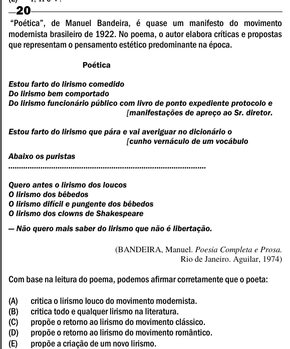

Texto extraído (pode conter ruído)

20  
“Poética”, de Manuel Bandeira, é quase um manifesto do movimento  
modernista brasileiro de 1922. No poema, o autor elabora críticas e propostas  
que representam o pensamento estético predominante na época.  
Poética  
Estou farto do lirismo comedido  
Do lirismo bem comportado  
Do lirismo funcionário público com livro de ponto expediente protocolo e  
[manifestações de apreço ao Sr. diretor.  
Estou farto do lirismo que pára e vai averiguar no dicionário o  
[cunho vernáculo de um vocábulo  
Abaixo os puristas  
............................................................................................  
Quero antes o lirismo dos loucos  
O lirismo dos bêbedos  
O lirismo difícil e pungente dos bêbedos  
O lirismo dos clowns de Shakespeare  
— Não quero mais saber do lirismo que não é libertação.  
(BANDEIRA, Manuel. Poesia Completa e Prosa.  
Rio de Janeiro. Aguilar, 1974)  
Com base na leitura do poema, podemos afirmar corretamente que o poeta:  
(A)  
critica o lirismo louco do movimento modernista.  
(B)  
critica todo e qualquer lirismo na literatura.  
(C)  
propõe o retorno ao lirismo do movimento clássico.  
(D)  
propõe o retorno ao lirismo do movimento romântico.  
(E)  
propõe a criação de um novo lirismo.

