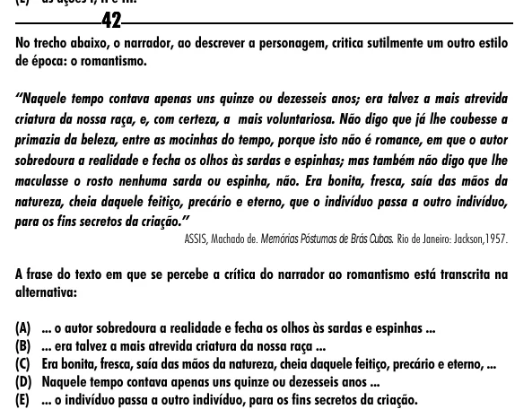

Texto extraído (pode conter ruído)

42  
No trecho abaixo, o narrador, ao descrever a personagem, critica sutilmente um outro estilo  
de época: o romantismo.  
“Naquele tempo contava apenas uns quinze ou dezesseis anos; era talvez a mais atrevida  
criatura da nossa raça, e, com certeza, a mais voluntariosa. Não digo que já lhe coubesse a  
primazia da beleza, entre as mocinhas do tempo, porque isto não é romance, em que o autor  
sobredoura a realidade e fecha os olhos às sardas e espinhas; mas também não digo que lhe  
maculasse o rosto nenhuma sarda ou espinha, não. Era bonita, fresca, saía das mãos da  
natureza, cheia daquele feitiço, precário e eterno, que o indivíduo passa a outro indivíduo,  
para os fins secretos da criação.”  
ASSIS, Machado de. Memórias Póstumas de Brás Cubas. Rio de Janeiro: Jackson,1957.  
A frase do texto em que se percebe a crítica do narrador ao romantismo está transcrita na  
alternativa:  
(A) ... o autor sobredoura a realidade e fecha os olhos às sardas e espinhas ...  
(B) ... era talvez a mais atrevida criatura da nossa raça ...  
(C) Era bonita, fresca, saía das mãos da natureza, cheia daquele feitiço, precário e eterno, ...  
(D) Naquele tempo contava apenas uns quinze ou dezesseis anos ...  
(E) ... o indivíduo passa a outro indivíduo, para os fins secretos da criação.

