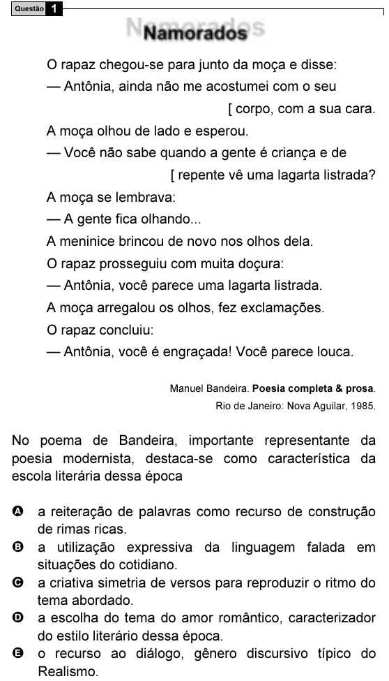

Texto extraído (pode conter ruído)

1  
Questão  
O rapaz chegou-se para junto da moça e disse:  
— Antônia, ainda não me acostumei com o seu  
[ corpo, com a sua cara.  
A moça olhou de lado e esperou.  
— Você não sabe quando a gente é criança e de  
[ repente vê uma lagarta listrada?  
A moça se lembrava:  
— A gente fica olhando...  
A meninice brincou de novo nos olhos dela.  
O rapaz prosseguiu com muita doçura:  
— Antônia, você parece uma lagarta listrada.  
A moça arregalou os olhos, fez exclamações.  
O rapaz concluiu:  
— Antônia, você é engraçada! Você parece louca.  
Manuel Bandeira. Poesia completa & prosa.  
Rio de Janeiro: Nova Aguilar, 1985.  
No poema de Bandeira, importante representante da  
poesia modernista, destaca-se como característica da  
escola literária dessa época  
A a reiteração de palavras como recurso de construção  
de rimas ricas.  
B a utilização expressiva da linguagem falada em  
situações do cotidiano.  
C a criativa simetria de versos para reproduzir o ritmo do  
tema abordado.  
D a escolha do tema do amor romântico, caracterizador  
do estilo literário dessa época.  
E o recurso ao diálogo, gênero discursivo típico do  
Realismo.

