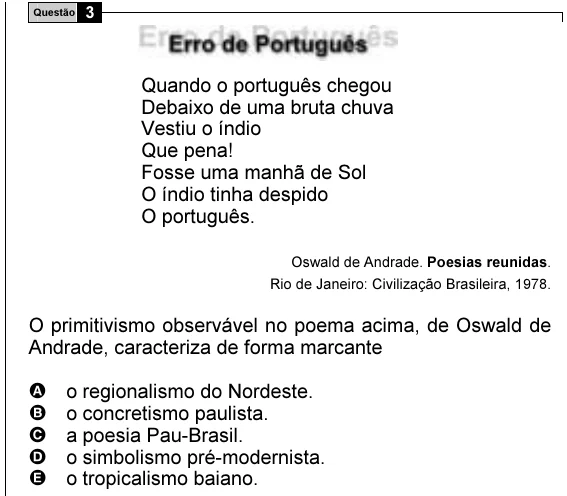

Texto extraído (pode conter ruído)

3  
Questão  
Quando o português chegou  
Debaixo de uma bruta chuva  
Vestiu o índio  
Que pena!  
Fosse uma manhã de Sol  
O índio tinha despido  
O português.  
Oswald de Andrade. Poesias reunidas.  
Rio de Janeiro: Civilização Brasileira, 1978.  
O primitivismo observável no poema acima, de Oswald de  
Andrade, caracteriza de forma marcante  
A  
o regionalismo do Nordeste.  
B  
o concretismo paulista.  
C  
a poesia Pau-Brasil.  
D  
o simbolismo pré-modernista.  
E  
o tropicalismo baiano.

