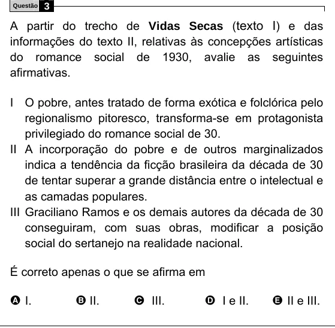

Texto extraído (pode conter ruído)

Questão  
3  
A partir do trecho de Vidas Secas ( texto I ) e das  
informações do texto II, relativas às concepções artísticas  
do romance social de 1930, avalie as seguintes  
afirmativas.  
I O pobre, antes tratado de forma exótica e folclórica pelo  
regionalismo pitoresco, transforma-se em protagonista  
privilegiado do romance social de 30.  
II A incorporação do pobre e de outros marginalizados  
indica a tendência da ficção brasileira da década de 30  
de tentar superar a grande distância entre o intelectual e  
as camadas populares.  
III Graciliano Ramos e os demais autores da década de 30  
conseguiram, com suas obras, modificar a posição  
social do sertanejo na realidade nacional.  
É correto apenas o que se afirma em  
A I.  
B II.  
C III.  
D I e II.  
E II e III.

