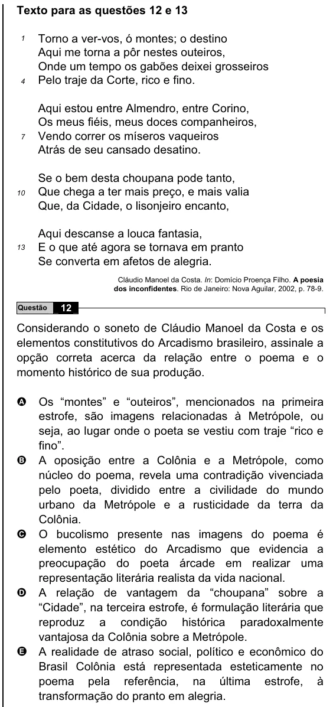

Texto extraído (pode conter ruído)

Texto para as questões 12 e 13  
Torno a ver-vos, ó montes; o destino  
1  
Aqui me torna a pôr nestes outeiros,  
Onde um tempo os gabões deixei grosseiros  
Pelo traje da Corte, rico e fino.  
4  
Aqui estou entre Almendro, entre Corino,  
Os meus fiéis, meus doces companheiros,  
Vendo correr os míseros vaqueiros  
7  
Atrás de seu cansado desatino.  
Se o bem desta choupana pode tanto,  
Que chega a ter mais preço, e mais valia  
10  
Que, da Cidade, o lisonjeiro encanto,  
Aqui descanse a louca fantasia,  
E o que até agora se tornava em pranto  
13  
Se converta em afetos de alegria.  
Cláudio Manoel da Costa. In: Domício Proença Filho. A poesia  
dos inconfidentes. Rio de Janeiro: Nova Aguilar, 2002, p. 78-9.  
Questão  
12  
Considerando o soneto de Cláudio Manoel da Costa e os  
elementos constitutivos do Arcadismo brasileiro, assinale a  
opção correta acerca da relação entre o poema e o  
momento histórico de sua produção.  
A  
Os “montes” e “outeiros”, mencionados na primeira  
estrofe, são imagens relacionadas à Metrópole, ou  
seja, ao lugar onde o poeta se vestiu com traje “rico e  
fino”.  
B A oposição entre a Colônia e a Metrópole, como  
núcleo do poema, revela uma contradição vivenciada  
pelo poeta, dividido entre a civilidade do mundo  
urbano da Metrópole e a rusticidade da terra da  
Colônia.  
C O bucolismo presente nas imagens do poema é  
elemento estético do Arcadismo que evidencia a  
preocupação do poeta árcade em realizar uma  
representação literária realista da vida nacional.  
D A relação de vantagem da “choupana” sobre a  
“Cidade”, na terceira estrofe, é formulação literária que  
reproduz a condição histórica paradoxalmente  
vantajosa da Colônia sobre a Metrópole.  
E A realidade de atraso social, político e econômico do  
Brasil Colônia está representada esteticamente no  
poema pela referência, na última estrofe, à  
transformação do pranto em alegria.

